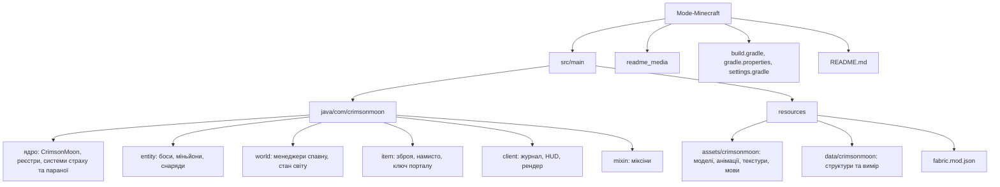
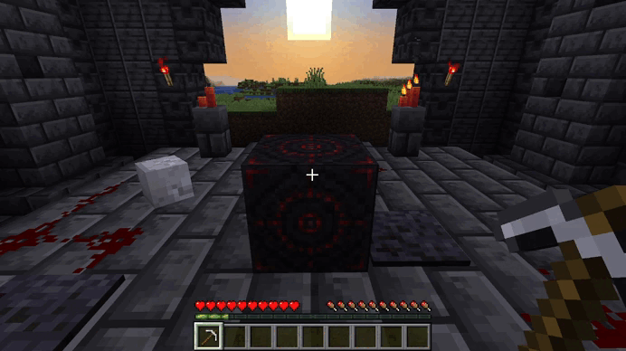
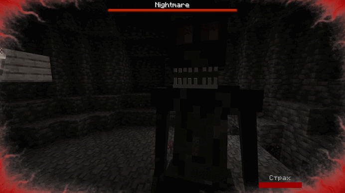
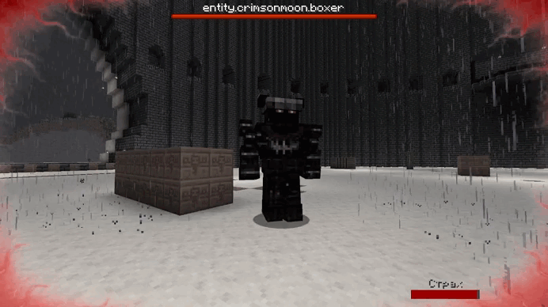
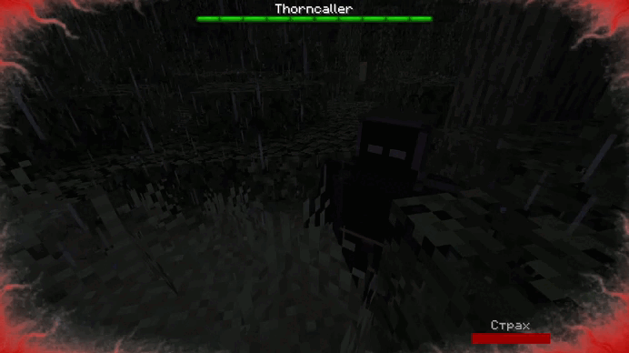
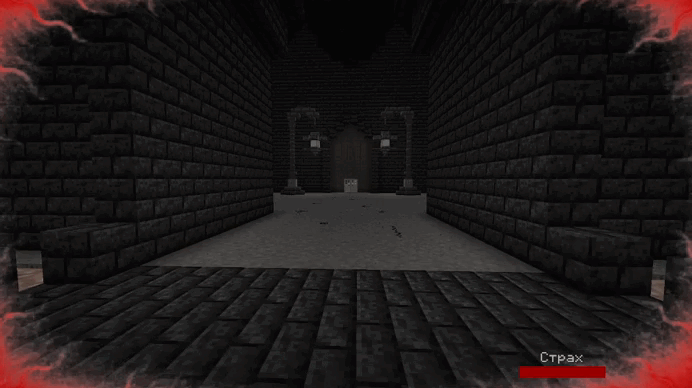
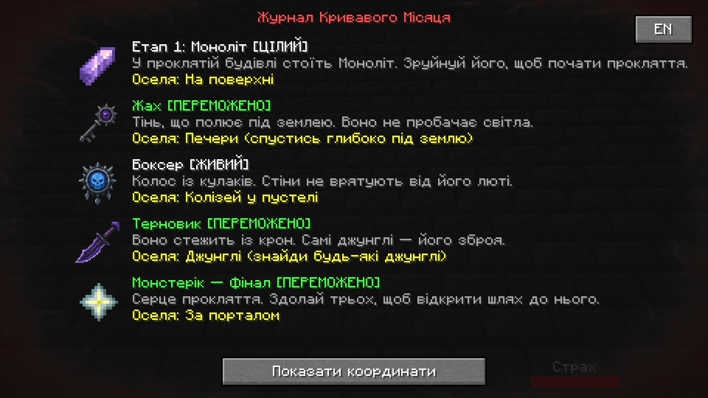
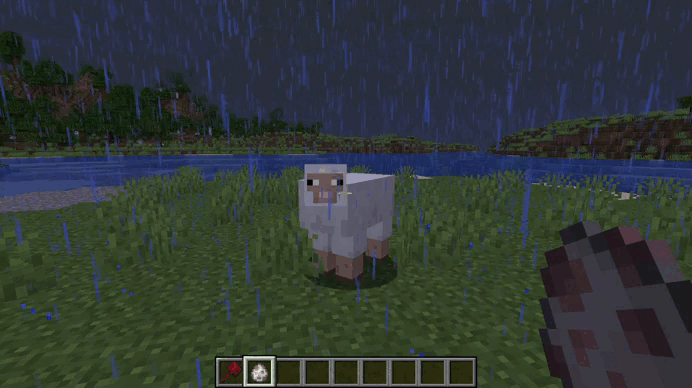
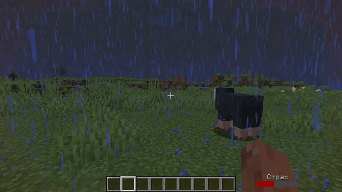
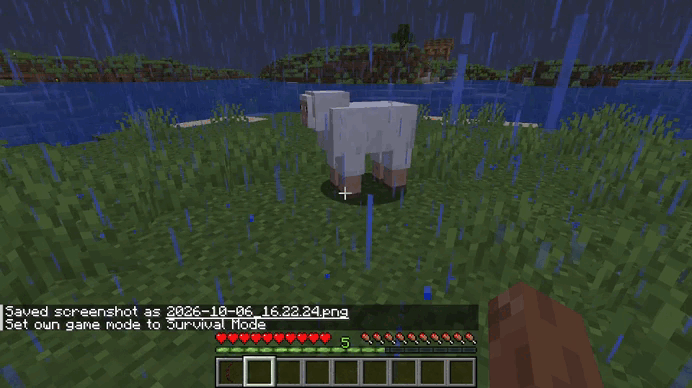

# Crimson Moon

---

<a name="articles"></a>

## Зміст (Table of contents)

- [Опис проєкту](#опис-проєкту)
- [Склад команди](#склад-команди)
- [Де завантажити мод](#де-завантажити-мод)
- [Як встановити мод](#як-встановити-мод)
- [Як запустити й протестувати](#як-запустити-й-протестувати)
  - [Запуск із вихідного коду](#запуск-із-вихідного-коду)
- [Що міститься в репозиторії](#що-міститься-в-репозиторії)
- [Концепція проєкту та ідея](#концепція-проєкту-та-ідея)
- [Боси](#боси)
- [Журнал босів](#журнал-босів)
- [Структури та світ](#структури-та-світ)
- [Спорядження та моби](#спорядження-та-моби)
- [Основна технічна частина](#основна-технічна-частина)
  - [1. Основні модулі проєкту](#1-основні-модулі-проєкту)
    - [1.1 Ядро мода](#11-ядро-мода)
    - [1.2 Боси (папка entity)](#12-боси-папка-entity)
    - [1.3 Менеджери спавну та світу (папка world)](#13-менеджери-спавну-та-світу-папка-world)
    - [1.4 Стан світу](#14-стан-світу)
    - [1.5 Журнал босів](#15-журнал-босів)
    - [1.6 Портал і ключ](#16-портал-і-ключ)
    - [1.7 Предмети](#17-предмети)
    - [1.8 Додаткові системи (страх, параноя, спостерігач)](#18-додаткові-системи-страх-параноя-спостерігач)
  - [2. Основні механіки](#2-основні-механіки)
    - [2.1 Система прокляття](#21-система-прокляття)
    - [2.2 Чотири боси](#22-чотири-боси)
      - [Бос 1 — Жах (Nightmare)](#бос-1--жах-nightmare)
      - [Бос 2 — Боксер (Boxer)](#бос-2--боксер-boxer)
      - [Бос 3 — Терновик (Thorncaller)](#бос-3--терновик-thorncaller)
      - [Бос 4 — Монстерік (Monsterik, фінал)](#бос-4--монстерік-monsterik-фінал)
    - [2.3 Портал до фінального боса](#23-портал-до-фінального-боса)
    - [2.4 Журнал босів](#24-журнал-босів)
    - [2.5 Особлива зброя босів](#25-особлива-зброя-босів)
      - [Ресурс «Страх»](#ресурс-страх)
      - [Кривава булава](#кривава-булава)
      - [Кривавий посох](#кривавий-посох)
      - [Кривавий лук](#кривавий-лук)
      - [Порівняння](#порівняння)
    - [2.6 Фінал і зняття прокляття](#26-фінал-і-зняття-прокляття)
- [Технічні проблеми та їх вирішення](#технічні-проблеми-та-їх-вирішення)
- [Наскільки заглибились у Java](#наскільки-заглибились-у-java)
- [Висновок](#висновок)

---

## Опис проєкту

**Crimson Moon** — це масштабний хоррор-пригодницький мод для **Minecraft**, розроблений на базі **Fabric API**. Мод змінює звичний кубічний світ, перетворюючи його на прокляте місце. Зруйнуйте Моноліт, пробудіть прадавнє прокляття та здолайте чотирьох унікальних босів, кожен з яких має власний штучний інтелект, арену та бойові механіки. Відстежуйте свій прогрес за допомогою вбудованого журналу босів та пробивайтеся до фінальної битви за межами звичного виміру.

<details>
<summary>English version</summary>

**Crimson Moon** is a large-scale horror adventure mod for **Minecraft**, built on **Fabric API**. The mod turns the familiar blocky world into a cursed place. Destroy the Monolith, awaken an ancient curse and defeat four unique bosses, each with its own artificial intelligence, arena and combat mechanics. Track your progress with the built-in boss journal and fight your way to the final battle beyond the familiar dimension.

</details>

[⬆️Table of contents](#articles)

---

## Склад команди

Над проєктом працювала команда з трьох учасників. Кожен відповідав за свою частину роботи — від коду до 3D-моделей і документації.

| Учасник | Роль | Що робив |
|---------|------|----------|
| [Володимир](https://github.com/Pranichek) | Team Lead, Java-розробник | Розподіляв задачі та планував зустрічі команди, писав програмну логіку мода, підготував розділи README про встановлення, запуск і структуру проєкту |
| [Євгеній](https://github.com/BilashEvgen) | Java-розробник | Писав програмну логіку мода, описав основні модулі та механіки в README, записав GIF-демонстрації механік |
| [Аліна](https://github.com/AlinaSoruhan) | Дизайнерка | Створила 3D-моделі, текстури та анімації босів у Blockbench, написала концепцію проєкту та висновок |

<details>
<summary>English version</summary>

The project was built by a team of three. Each member was responsible for their own part of the work, from code to 3D models and documentation.

| Member | Role | Contribution |
|--------|------|--------------|
| [Volodymyr](https://github.com/Pranichek) | Team Lead, Java developer | Distributed tasks and planned team meetings, wrote the mod's game logic, prepared the README sections on installation, launching and project structure |
| [Yevhenii](https://github.com/BilashEvgen) | Java developer | Wrote the mod's game logic, documented the main modules and mechanics in the README, recorded the GIF demos of the mechanics |
| [Alina](https://github.com/AlinaSoruhan) | Designer | Created the boss 3D models, textures and animations in Blockbench, wrote the project concept and conclusion |

</details>

[⬆️Table of contents](#articles)

---

## Де завантажити мод

Мод опубліковано на двох платформах: на CurseForge під назвою **Crimson Moon: The Curse** і на Planet Minecraft під назвою **Crimson Moon**. Актуальна версія — **1.0.0** (`crimsonmoon-1.0.0.jar`) для **Minecraft 1.20.1** на **Fabric**.

| Платформа | Посилання |
|-----------|-----------|
| CurseForge | [Crimson Moon: The Curse](https://www.curseforge.com/minecraft/mc-mods/crimson-moon-the-curse) |
| Planet Minecraft | [Crimson Moon](https://www.planetminecraft.com/mod/crimson-moon-7049895/) |
| GitHub (вихідний код) | [Mode-Minecraft](https://github.com/Pranichek/Mode-Minecraft) |

<details>
<summary>English version</summary>

The mod is published on two platforms: on CurseForge as **Crimson Moon: The Curse** and on Planet Minecraft as **Crimson Moon**. The current version is **1.0.0** (`crimsonmoon-1.0.0.jar`) for **Minecraft 1.20.1** on **Fabric**.

| Platform | Link |
|----------|------|
| CurseForge | [Crimson Moon: The Curse](https://www.curseforge.com/minecraft/mc-mods/crimson-moon-the-curse) |
| Planet Minecraft | [Crimson Moon](https://www.planetminecraft.com/mod/crimson-moon-7049895/) |
| GitHub (source code) | [Mode-Minecraft](https://github.com/Pranichek/Mode-Minecraft) |

</details>

[⬆️Table of contents](#articles)

---

## Як встановити мод

Нижче наведена покрокова інструкція, як встановити Crimson Moon на свій комп'ютер. Мод працює **лише на Minecraft Java Edition 1.20.1** із завантажувачем **Fabric**.

### Що потрібно

| Що | Версія | Де взяти |
|----|--------|----------|
| Minecraft Java Edition | 1.20.1 | Офіційний лаунчер Minecraft |
| Fabric Loader | остання для 1.20.1 | [fabricmc.net](https://fabricmc.net/use/installer/) |
| **Crimson Moon** | 1.0.0 | [CurseForge](https://www.curseforge.com/minecraft/mc-mods/crimson-moon-the-curse) або [Planet Minecraft](https://www.planetminecraft.com/mod/crimson-moon-7049895/) |
| Fabric API | для 1.20.1 | [Modrinth](https://modrinth.com/mod/fabric-api) |
| GeckoLib | для 1.20.1 (Fabric) | [Modrinth](https://modrinth.com/mod/geckolib) |
| Trinkets | для 1.20.1 | [Modrinth](https://modrinth.com/mod/trinkets) |
| Cardinal Components API | для 1.20.1 | [Modrinth](https://modrinth.com/mod/cardinal-components-api) |
| Disable Custom Worlds Advice | для 1.20.x | [Modrinth](https://modrinth.com/mod/dcwa) |

Навіщо потрібна кожна залежність:
- **Fabric API** — базові події та реєстри, на яких тримається весь код мода (тики сервера, вхід гравця, ламання блоків, передача пакетів).
- **GeckoLib** — моделі та анімації босів, створені в Blockbench.
- **Trinkets** — окремий слот для Кривавого намиста.
- **Cardinal Components API** — бібліотека, на якій працює Trinkets.
- **Disable Custom Worlds Advice** — прибирає попередження «Експериментальні налаштування», яке Minecraft показує через власний вимір арени фінального боса.

### Покрокова інструкція

1. **Встановіть Minecraft 1.20.1.** Відкрийте офіційний лаунчер, на вкладці «Встановлення» створіть конфігурацію з версією `release 1.20.1` і запустіть її один раз, щоб гра завантажила свої файли.
2. **Встановіть Fabric.** Завантажте Fabric Installer з [fabricmc.net](https://fabricmc.net/use/installer/) і запустіть його. Виберіть вкладку **Client**, версію Minecraft **1.20.1**, останню версію Loader і натисніть **Install**. У лаунчері з'явиться профіль `fabric-loader-1.20.1`.


3. **Завантажте мод.** На сторінці [CurseForge](https://www.curseforge.com/minecraft/mc-mods/crimson-moon-the-curse) відкрийте вкладку **Files** і завантажте `crimsonmoon-1.0.0.jar`. Також мод можна завантажити з [Planet Minecraft](https://www.planetminecraft.com/mod/crimson-moon-7049895/) кнопкою **Download Mod**.


4. **Завантажте залежності.** Для кожного мода з таблиці вище відкрийте вкладку **Versions**, виставте фільтри **1.20.1** і **Fabric** та завантажте `.jar`-файл.
5. **Відкрийте папку `mods`.**
   - Windows: натисніть `Win + R`, введіть `%appdata%\.minecraft` і натисніть Enter, далі відкрийте папку `mods` (якщо її немає — створіть);
   - macOS: `~/Library/Application Support/minecraft/mods`;
   - Linux: `~/.minecraft/mods`.
6. **Покладіть усі `.jar` у папку `mods`**: сам мод і п'ять залежностей. Розпаковувати нічого не потрібно.


7. **Запустіть гру.** У лаунчері виберіть профіль `fabric-loader-1.20.1` і натисніть **Грати**.


> Якщо гра не запускається, найчастіше бракує однієї із залежностей або файл завантажено не для 1.20.1. Fabric зазвичай показує вікно помилки з назвою мода, якого не вистачає.

<details>
<summary>English version</summary>

Below is a step-by-step guide to installing Crimson Moon on your computer. The mod works **only on Minecraft Java Edition 1.20.1** with the **Fabric** loader.

**Requirements**

| What | Version | Where to get it |
|------|---------|-----------------|
| Minecraft Java Edition | 1.20.1 | Official Minecraft Launcher |
| Fabric Loader | latest for 1.20.1 | [fabricmc.net](https://fabricmc.net/use/installer/) |
| **Crimson Moon** | 1.0.0 | [CurseForge](https://www.curseforge.com/minecraft/mc-mods/crimson-moon-the-curse) or [Planet Minecraft](https://www.planetminecraft.com/mod/crimson-moon-7049895/) |
| Fabric API | for 1.20.1 | [Modrinth](https://modrinth.com/mod/fabric-api) |
| GeckoLib | for 1.20.1 (Fabric) | [Modrinth](https://modrinth.com/mod/geckolib) |
| Trinkets | for 1.20.1 | [Modrinth](https://modrinth.com/mod/trinkets) |
| Cardinal Components API | for 1.20.1 | [Modrinth](https://modrinth.com/mod/cardinal-components-api) |
| Disable Custom Worlds Advice | for 1.20.x | [Modrinth](https://modrinth.com/mod/dcwa) |

Why each dependency is needed:
- **Fabric API** — the core events and registries the whole mod is built on (server ticks, player joining, block breaking, network packets).
- **GeckoLib** — the boss models and animations made in Blockbench.
- **Trinkets** — a separate slot for the Blood Necklace.
- **Cardinal Components API** — the library Trinkets runs on.
- **Disable Custom Worlds Advice** — removes the "Experimental Settings" warning that Minecraft shows because of the custom final boss arena dimension.

**Step-by-step guide**

1. **Install Minecraft 1.20.1.** Open the official launcher, create an installation with version `release 1.20.1` on the **Installations** tab and launch it once so the game downloads its files.
2. **Install Fabric.** Download Fabric Installer from [fabricmc.net](https://fabricmc.net/use/installer/) and run it. Choose the **Client** tab, Minecraft version **1.20.1**, the latest Loader version and click **Install**. A `fabric-loader-1.20.1` profile will appear in the launcher.
3. **Download the mod.** On the [CurseForge](https://www.curseforge.com/minecraft/mc-mods/crimson-moon-the-curse) page, open the **Files** tab and download `crimsonmoon-1.0.0.jar`. You can also download the mod from [Planet Minecraft](https://www.planetminecraft.com/mod/crimson-moon-7049895/) with the **Download Mod** button.
4. **Download the dependencies.** For each mod in the table above, open the **Versions** tab, set the **1.20.1** and **Fabric** filters and download the `.jar` file.
5. **Open the `mods` folder.**
   - Windows: press `Win + R`, type `%appdata%\.minecraft`, press Enter and open the `mods` folder (create it if it does not exist);
   - macOS: `~/Library/Application Support/minecraft/mods`;
   - Linux: `~/.minecraft/mods`.
6. **Put all the `.jar` files into `mods`**: the mod itself and the five dependencies. Nothing needs to be unpacked.
7. **Launch the game.** Select the `fabric-loader-1.20.1` profile in the launcher and click **Play**.

> If the game does not start, a dependency is usually missing or a file was downloaded for a version other than 1.20.1. Fabric usually shows an error window with the name of the missing mod.

</details>

[⬆️Table of contents](#articles)

---

## Як запустити й протестувати

### Перший запуск

1. Запустіть гру з профілем `fabric-loader-1.20.1`.
2. Створіть новий світ: **Одиночна гра → Створити новий світ**. Для повного проходження радимо режим «Виживання». Якщо хочете швидко протестувати мод, увімкніть **«Дозволити чит-коди»**.
3. Зайдіть у світ. Попередження про експериментальні налаштування не з'явиться — його прибирає Disable Custom Worlds Advice.

### З чого починається проходження

1. **Знайдіть Моноліт.** Під час першого входу мод ставить структуру Моноліту на відстані від 20 до 1000 блоків від гравця. Натисніть **J** — у журналі босів видно координати Моноліту.


2. **Зруйнуйте Моноліт.** Як тільки ви зламаєте головний блок, світ накриває прокляття: починається гроза, накладається сліпота, лунають моторошні звуки, а в слоті Trinkets з'являється Криваве намисто.


3. **Полюйте на трьох вартових** у будь-якому порядку:
   - **Жах** — спустіться в печери нижче Y = 55;
   - **Боксер** — чекає в колізеї в найближчій пустелі, координати колізею є в журналі;
   - **Терновик** — з'являється лише в джунглях.
4. **Відкрийте шлях до порталу.** Після перемоги над трьома босами випадає ключ порталу. ПКМ ключем здалеку тягне вас у бік порталу, а ПКМ біля порталу переносить на арену фінального боса.
5. **Здолайте Монстеріка** й підберіть окуляри, які з нього випадуть. Через 10 секунд прокляття знімається, а всі гравці повертаються додому.

### Поради для швидкого тестування

Щоб на захисті не проходити все з нуля, зручно користуватися командами (потрібні увімкнені чит-коди):
- `/gamemode creative` — творчий режим; у творчому інвентарі є яйця спавну мобів мода;
- `/locate biome minecraft:desert` і `/locate biome minecraft:jungle` — знайти пустелю для колізею та джунглі для Терновика;
- `/tp @s <x> <y> <z>` — швидко переміститися до Моноліту чи колізею за координатами з журналу;
- `/monsterikboss spawn` — повторно викликати фінального боса на арені (автоспавн працює лише до його першої смерті).

### Запуск із вихідного коду

Цей спосіб потрібен, якщо ви хочете подивитися код мода або змінити його. Знадобляться **JDK 17** та **IntelliJ IDEA** (або інша IDE з підтримкою Gradle).

1. Клонуйте репозиторій і перейдіть у папку проєкту:

   ```bash
   # Завантажуємо копію репозиторію на свій комп'ютер
   git clone https://github.com/Pranichek/Mode-Minecraft.git
   # Переходимо в папку проєкту, де лежать build.gradle і gradlew
   cd Mode-Minecraft
   ```

2. Відкрийте папку в IntelliJ IDEA і дочекайтеся, поки Gradle завантажить усі залежності.
3. Запустіть Minecraft разом із модом:

   ```bash
   # macOS / Linux: runClient — Gradle-задача Fabric Loom,
   # яка збирає мод і відкриває клієнт Minecraft 1.20.1 з ним
   ./gradlew runClient
   ```

   ```bat
   :: Windows: та сама задача через gradlew.bat
   gradlew runClient
   ```

4. Щоб зібрати власний `.jar`, виконайте збірку — готовий файл з'явиться в папці `build/libs/`:

   ```bash
   # build — компілює код і пакує мод у .jar-файл
   ./gradlew build
   ```

<details>
<summary>English version</summary>

**First launch**

1. Launch the game with the `fabric-loader-1.20.1` profile.
2. Create a new world: **Singleplayer → Create New World**. For a full playthrough we recommend Survival mode. If you want to test the mod quickly, turn on **"Allow Cheats"**.
3. Enter the world. The experimental settings warning will not appear — Disable Custom Worlds Advice removes it.

**Where the playthrough begins**

1. **Find the Monolith.** On the first join, the mod places the Monolith structure 20 to 1000 blocks away from the player. Press **J** — the boss journal shows the Monolith coordinates.
2. **Destroy the Monolith.** As soon as you break its main block, the curse falls upon the world: a thunderstorm begins, blindness is applied, eerie sounds play and the Blood Necklace appears in the Trinkets slot.
3. **Hunt the three guardians** in any order:
   - **Nightmare** — go down into caves below Y = 55;
   - **Boxer** — waits in a colosseum in the nearest desert; the colosseum coordinates are in the journal;
   - **Thorncaller** — appears only in jungles.
4. **Open the way to the portal.** After the three bosses are defeated, the portal key drops. Right-clicking the key from afar pulls you towards the portal, and right-clicking near the portal takes you to the final boss arena.
5. **Defeat Monsterik** and pick up the glasses it drops. After 10 seconds the curse is lifted and all players return home.

**Quick testing tips**

To avoid replaying everything from scratch during the defense, use commands (cheats must be enabled):
- `/gamemode creative` — creative mode; the creative inventory contains spawn eggs for the mod's mobs;
- `/locate biome minecraft:desert` and `/locate biome minecraft:jungle` — find a desert for the colosseum and a jungle for Thorncaller;
- `/tp @s <x> <y> <z>` — quickly move to the Monolith or the colosseum using the journal coordinates;
- `/monsterikboss spawn` — summon the final boss again in the arena (auto-spawn works only until its first death).

**Running from source**

This option is for viewing or changing the mod's code. You will need **JDK 17** and **IntelliJ IDEA** (or another IDE with Gradle support).

1. Clone the repository and go to the project folder: `git clone https://github.com/Pranichek/Mode-Minecraft.git`, then `cd Mode-Minecraft`.
2. Open the folder in IntelliJ IDEA and wait for Gradle to download all dependencies.
3. Launch Minecraft with the mod: `./gradlew runClient` on macOS / Linux or `gradlew runClient` on Windows. `runClient` is a Fabric Loom Gradle task that builds the mod and opens a Minecraft 1.20.1 client with it.
4. To build your own `.jar`, run `./gradlew build` — the finished file will appear in `build/libs/`.

</details>

[⬆️Table of contents](#articles)

---

## Що міститься в репозиторії

Проєкт побудований за стандартною структурою Fabric-мода зі збіркою через Gradle. Нижче — схема основних папок і короткий опис кожної.



| Папка / файл | Що там лежить |
|--------------|---------------|
| `src/main/java/com/crimsonmoon/` | Ядро мода: точки входу, реєстри предметів, блоків, сутностей і вимірів, системи страху та параної, мережа журналу |
| `.../entity/` | Боси, їхні цілі ШІ, міньйони та снаряди |
| `.../world/` | Менеджери спавну босів і структур, завантажувач арени, стан світу |
| `.../item/` | Трофейна зброя, Криваве намисто, ключ порталу, службові класи |
| `.../client/` | Екран журналу босів, HUD страху, рендер |
| `.../mixin/` | Міксіни, що змінюють ванільну логіку Minecraft |
| `src/main/resources/assets/crimsonmoon/` | Моделі GeckoLib (`geo`), анімації, текстури, файли перекладу |
| `src/main/resources/data/crimsonmoon/` | Структури (Моноліт, колізей, портал, арена) і вимір `boss_realm` |
| `src/main/resources/fabric.mod.json` | Опис мода для Fabric: назва, версія, точки входу, залежності |
| `build.gradle`, `gradle.properties` | Налаштування збірки та версії бібліотек |
| `readme_media/` | Картинки та гіфки для цього README |

<details>
<summary>English version</summary>

The project follows the standard Fabric mod layout with a Gradle build. Below is a diagram of the main folders and a short description of each.

| Folder / file | Contents |
|---------------|----------|
| `src/main/java/com/crimsonmoon/` | Mod core: entry points, registries of items, blocks, entities and dimensions, the Fear and Paranoia systems, journal networking |
| `.../entity/` | Bosses, their AI goals, minions and projectiles |
| `.../world/` | Boss and structure spawn managers, the arena loader, world state |
| `.../item/` | Trophy weapons, the Blood Necklace, the portal key, utility classes |
| `.../client/` | Boss journal screen, Fear HUD, rendering |
| `.../mixin/` | Mixins that change vanilla Minecraft logic |
| `src/main/resources/assets/crimsonmoon/` | GeckoLib models (`geo`), animations, textures, translation files |
| `src/main/resources/data/crimsonmoon/` | Structures (Monolith, colosseum, portal, arena) and the `boss_realm` dimension |
| `src/main/resources/fabric.mod.json` | Mod description for Fabric: name, version, entry points, dependencies |
| `build.gradle`, `gradle.properties` | Build settings and library versions |
| `readme_media/` | Images and GIFs for this README |

</details>

[⬆️Table of contents](#articles)

---

## Концепція проєкту та ідея

Ідея створення **Crimson Moon** народилася з бажання принести в Minecraft справжню атмосферу безпорадності, психологічного тиску та хардкору. Під час презентації та обговорення проєктів з іншими командами ми помітили, що **ніхто не обрав жанр хоррору**. Це стало для нас головним тригером та мотивацією: ми вирішили створити унікальний продукт, який виділятиметься на тлі інших та запропонує гравцям унікальний геймплейний досвід.

### Задум гри

Світ гри не є ворожим із самого початку. Гравець сам активує свій кошмар. Усе починається з пошуку структури Моноліту. Як тільки головний блок руйнується — світ змінюється назавжди:
- На світ обрушується шторм.
- Екран гравця втрачає кольори (ефект десатурації), занурюючи в похмуру, сіру атмосферу.
- Екран починає блимати, з'являються ембієнтні моторошні звуки, викликаючи постійне почуття того, що за тобою спостерігають.
- На гравця накладається прокляття, він отримує Криваве намисто (Blood Necklace) і стає ціллю для чотирьох грізних вартових.

<details>
<summary>English version</summary>

**Project concept and idea**

The idea for **Crimson Moon** came from a wish to bring a real atmosphere of helplessness, psychological pressure and hardcore gameplay into Minecraft. While presenting and discussing projects with other teams, we noticed that **nobody had chosen the horror genre**. That became our main trigger and motivation: we decided to create a unique product that would stand out from the others and offer players a unique gameplay experience.

**Game idea**

The game world is not hostile from the start. The player triggers their own nightmare. Everything begins with the search for the Monolith structure. As soon as its main block is destroyed, the world changes forever:
- A storm falls upon the world.
- The player's screen loses its colours (a desaturation effect), plunging them into a gloomy grey atmosphere.
- The screen starts flickering and eerie ambient sounds appear, creating a constant feeling of being watched.
- The player is cursed, receives the Blood Necklace and becomes the target of four fearsome guardians.

</details>

[⬆️Table of contents](#articles)

---

## Боси

Для просування сюжетом гравцеві необхідно здолати трьох перших босів-вартових, щоб отримати ключ від порталу, який вкаже шлях до фінального виміру. Один із босів постійно переслідує, лякає та спостерігає за гравцем здалеку, тримаючи в напрузі всю гру.

- **Жах (Nightmare) — мисливець печер:**
  Тінь, що полює глибоко під землею. Він не просто чекає на гравця — він переслідує його крізь стіни, вміє самостійно викопуватися з блоків, якщо його заблокувати, і здатний миттєво з'явитися прямо за спиною, якщо гравець спробує сховатися.
- **Боксер (Boxer) — колос колізею:**
  Титанічний боєць ближнього бою, який чекає на вас у величезній структурі колізею в пустелі. Битва з ним складається з **трьох фаз**. Він використовує стрімкі ривки, стрибки з нищівною ударною хвилею, аперкоти, захвати та стає значно агресивнішим у міру втрати здоров'я.
- **Терновик (Thorncaller) — мисливець джунглів:**
  Охоронець, який з'являється лише в біомі джунглів. Його унікальний ШІ дозволяє йому лазити по деревах та ховатися в кронах. Він атакує зненацька: викликає шипи з-під землі, запускає голковий шторм та б'є точковими терновими піками, які отруюють і сповільнюють гравця.
- **Монстерік (Monsterik) — фінальний бос:**
  Серце всього прокляття. Доступ до нього заблокований, поки живі інші три варти. Тільки об'єднавши їхні сили в ключ порталу, гравець зможе знайти прихований портал у далеких землях і перенестися в кастомний вимір (Boss Arena) для фінальної, найскладнішої битви.

<details>
<summary>English version</summary>

To progress through the story, the player must defeat the first three guardian bosses to obtain the portal key, which shows the way to the final dimension. One of the bosses constantly stalks, frightens and watches the player from afar, keeping them on edge for the whole game.

- **Nightmare — the cave hunter:**
  A shadow that hunts deep underground. It does not just wait for the player — it chases them through walls, can dig itself out of blocks if trapped, and can instantly appear right behind the player if they try to hide.
- **Boxer — the colossus of the colosseum:**
  A titanic melee fighter waiting for you in a huge colosseum structure in the desert. The fight with him has **three phases**. He uses swift dashes, leaps with a crushing shockwave, uppercuts and grabs, and becomes much more aggressive as his health drops.
- **Thorncaller — the jungle hunter:**
  A guardian that appears only in the jungle biome. Its unique AI lets it climb trees and hide in the canopy. It attacks without warning: it summons spikes from the ground, unleashes a needle storm and strikes with precise thorn lances that poison and slow the player.
- **Monsterik — the final boss:**
  The heart of the whole curse. Access to it is blocked while the other three guardians are alive. Only by uniting their power in the portal key can the player find the hidden portal in distant lands and travel to a custom dimension (Boss Arena) for the final, hardest battle.

</details>

[⬆️Table of contents](#articles)

---

## Журнал босів

Натиснувши клавішу **J**, гравець відкриває кастомний внутрішньоігровий інтерфейс журналу:
- **Трекінг полювання:** Візуальний статус кожного боса (живий чи переможений).
- **Лор та підказки:** Описи босів та місця їхнього знаходження.
- **Навігація:** Можливість дізнатися точні координати Моноліту та колізею.
- **Локалізація:** Повна підтримка двох мов — української та англійської.

<details>
<summary>English version</summary>

By pressing **J**, the player opens a custom in-game journal interface:
- **Hunt tracking:** visual status of each boss (alive or defeated).
- **Lore and hints:** boss descriptions and where to find them.
- **Navigation:** the exact coordinates of the Monolith and the colosseum.
- **Localization:** full support for two languages — Ukrainian and English.

</details>

[⬆️Table of contents](#articles)

---

## Структури та світ

Мод генерує як декоративні структури для занурення в атмосферу, так і ключові арени:
- **Будівля Моноліту** — прокляте місце старту.
- **Колізей** — колосальна пустельна арена для битви з Боксером.
- **Портал** — таємна споруда, прихована далеко в світі, що веде до фіналу.
- **Арена боса** — окремий кастомний вимір, створений виключно для фінальної битви з Монстеріком.

<details>
<summary>English version</summary>

The mod generates both decorative structures for immersion and key arenas:
- **Monolith building** — the cursed starting place.
- **Colosseum** — a colossal desert arena for the fight with the Boxer.
- **Portal** — a secret structure hidden far away in the world that leads to the finale.
- **Boss Arena** — a separate custom dimension made exclusively for the final battle with Monsterik.

</details>

[⬆️Table of contents](#articles)

---

## Спорядження та моби

Щоб допомогти гравцеві вижити в цьому кошмарі, ми додали розгалужену систему контенту:
- **Криваве озброєння:** Повний набір інструментів та зброї — меч, кирка, сокира, лопата, мотика, а також унікальні лук, булава та магічна палиця.
- **Кривава броня:** Сет захисту (шолом, нагрудник, поножі, чоботи) та кривавий щит.
- **Аксесуари:** Криваве намисто, що інтегрується через мод *Trinkets*.
- **Ключ від порталу:** Випадає з третього боса. При натисканні правою кнопкою миші притягує гравця в бік порталу, а перебуваючи поруч — телепортує у вимір боса.
- **Алхімія:** Спеціальні кастомні зілля — зілля Битви, Берсерка та Героїчне зілля.
- **Ресурси:** Нова кривава руда та злитки для крафту всього спорядження.
- **Поплічники:** Криваві бродяги, яких боси закликають під час файтів.

<details>
<summary>English version</summary>

To help the player survive this nightmare, we added an extensive content system:
- **Blood weapons:** a full set of tools and weapons — sword, pickaxe, axe, shovel, hoe, plus a unique bow, mace and magic staff.
- **Blood armor:** a protective set (helmet, chestplate, leggings, boots) and a blood shield.
- **Accessories:** the Blood Necklace, integrated through the *Trinkets* mod.
- **Portal key:** drops from the third boss. Right-clicking pulls the player towards the portal, and near the portal it teleports them to the boss dimension.
- **Alchemy:** special custom potions — the Battle, Berserk and Heroic potions.
- **Resources:** new blood ore and ingots for crafting all the gear.
- **Minions:** Bloodwalkers that bosses summon during fights.

</details>

[⬆️Table of contents](#articles)

---

## Основна технічна частина

> Мод **Crimson Moon** (Fabric, Minecraft 1.20.x, GeckoLib для моделей, Trinkets для слотів).
> Усі посилання нижче ведуть на файли в репозиторії:
> `https://github.com/Pranichek/Mode-Minecraft/blob/main/src/main/java/com/crimsonmoon/...`

<details>
<summary>English version</summary>

> The **Crimson Moon** mod (Fabric, Minecraft 1.20.x, GeckoLib for models, Trinkets for slots).
> All links below lead to files in the repository:
> `https://github.com/Pranichek/Mode-Minecraft/blob/main/src/main/java/com/crimsonmoon/...`

</details>

[⬆️Table of contents](#articles)

---

## 1. Основні модулі проєкту

Весь код лежить у пакеті `com.crimsonmoon`. Він розділений на: ядро (ініціалізація, реєстри), `entity` (боси та їхні цілі ШІ), `world` (спавн босів і стан світу), `item` (предмети), `client` (GUI, рендер, звук), `mixin`.

<details>
<summary>English version</summary>

All the code lives in the `com.crimsonmoon` package. It is split into: core (initialization, registries), `entity` (bosses and their AI goals), `world` (boss spawning and world state), `item` (items), `client` (GUI, rendering, sound), `mixin`.

</details>

### 1.1 Ядро мода

| Файл | Клас | За що відповідає |
|------|------|------------------|
| [CrimsonMoon.java](https://github.com/Pranichek/Mode-Minecraft/blob/main/src/main/java/com/crimsonmoon/CrimsonMoon.java) | `CrimsonMoon` | Точка входу (`ModInitializer`). Реєструє все: предмети, блоки, сутностей, менеджери. Тут же живе **система прокляття** (`applyCurse`, `removeCurse`), спавн Моноліту, спавн боса Nightmare у печері, фінальний відлік та «астральна проєкція» окулярів |
| [CrimsonMoonClient.java](https://github.com/Pranichek/Mode-Minecraft/blob/main/src/main/java/com/crimsonmoon/CrimsonMoonClient.java) | `CrimsonMoonClient` | Клієнтська частина: клавіші (**J** — журнал, окрема клавіша для окулярів), реєстрація рендерерів босів, HUD-оверлеї |
| [ModEntities.java](https://github.com/Pranichek/Mode-Minecraft/blob/main/src/main/java/com/crimsonmoon/ModEntities.java) | `ModEntities` | Реєстр усіх сутностей: боси (Nightmare, Boxer, Thorncaller, Monsterik), Bloodwalker, Watcher, снаряди |
| [ModItems.java](https://github.com/Pranichek/Mode-Minecraft/blob/main/src/main/java/com/crimsonmoon/ModItems.java) | `ModItems` | Реєстр предметів (див. 1.7) |
| [ModBlocks.java](https://github.com/Pranichek/Mode-Minecraft/blob/main/src/main/java/com/crimsonmoon/ModBlocks.java) | `ModBlocks` | Блоки: `MONOLIT` і кривава руда |
| [ModDimensions.java](https://github.com/Pranichek/Mode-Minecraft/blob/main/src/main/java/com/crimsonmoon/ModDimensions.java) | `ModDimensions` | Ключ виміру `BOSS_REALM` — арена фінального боса |

<details>
<summary>English version</summary>

| File | Class | Responsibility |
|------|-------|----------------|
| `CrimsonMoon.java` | `CrimsonMoon` | Entry point (`ModInitializer`). Registers everything: items, blocks, entities, managers. The **curse system** (`applyCurse`, `removeCurse`) also lives here, along with Monolith spawning, spawning the Nightmare boss in a cave, the final countdown and the glasses' "astral projection" |
| `CrimsonMoonClient.java` | `CrimsonMoonClient` | Client side: key bindings (**J** — journal, a separate key for the glasses), boss renderer registration, HUD overlays |
| `ModEntities.java` | `ModEntities` | Registry of all entities: bosses (Nightmare, Boxer, Thorncaller, Monsterik), Bloodwalker, Watcher, projectiles |
| `ModItems.java` | `ModItems` | Item registry (see 1.7) |
| `ModBlocks.java` | `ModBlocks` | Blocks: `MONOLIT` and blood ore |
| `ModDimensions.java` | `ModDimensions` | Key of the `BOSS_REALM` dimension — the final boss arena |

</details>

[⬆️Table of contents](#articles)

### 1.2 Боси (папка entity)

Кожен бос — окремий клас, який наслідує `HostileEntity` (Thorncaller — `ZombieEntity`) і працює через GeckoLib (`GeoEntity`). Модель, текстура та анімації лежать у `resources/assets/crimsonmoon/geo` та `.../animations`.

| Файл | Клас | За що відповідає |
|------|------|------------------|
| [NightmareEntity.java](https://github.com/Pranichek/Mode-Minecraft/blob/main/src/main/java/com/crimsonmoon/entity/NightmareEntity.java) | `NightmareEntity` | Бос №1 «Жах». Переслідування, поява за спиною, вигризання з блоків |
| [StalkPlayerGoal.java](https://github.com/Pranichek/Mode-Minecraft/blob/main/src/main/java/com/crimsonmoon/entity/StalkPlayerGoal.java) | `StalkPlayerGoal` | Ціль ШІ: іти до гравця навіть без прямої видимості |
| [NightmareMeleeAttackGoal.java](https://github.com/Pranichek/Mode-Minecraft/blob/main/src/main/java/com/crimsonmoon/entity/NightmareMeleeAttackGoal.java) | `NightmareMeleeAttackGoal` | Ближній бій Nightmare |
| [BoxerEntity.java](https://github.com/Pranichek/Mode-Minecraft/blob/main/src/main/java/com/crimsonmoon/entity/BoxerEntity.java) | `BoxerEntity` | Бос №2 «Боксер». Три фази, ривок, стрибок, ударна хвиля, телепорт у люті |
| [BoxerStalkGoal.java](https://github.com/Pranichek/Mode-Minecraft/blob/main/src/main/java/com/crimsonmoon/entity/BoxerStalkGoal.java) | `BoxerStalkGoal` | Ціль ШІ Боксера: підкрадання до гравця |
| [ThorncallerEntity.java](https://github.com/Pranichek/Mode-Minecraft/blob/main/src/main/java/com/crimsonmoon/entity/ThorncallerEntity.java) | `ThorncallerEntity` | Бос №3 «Терновик». Чотири здібності (призов, шипи, шторм, піка) |
| [ThorncallerTreeClimbGoal.java](https://github.com/Pranichek/Mode-Minecraft/blob/main/src/main/java/com/crimsonmoon/entity/ThorncallerTreeClimbGoal.java), [ThorncallerTreeHideGoal.java](https://github.com/Pranichek/Mode-Minecraft/blob/main/src/main/java/com/crimsonmoon/entity/ThorncallerTreeHideGoal.java) | `...TreeClimbGoal`, `...TreeHideGoal` | Взаємодія з джунглями: лазить по деревах і ховається за стовбурами |
| [BloodwalkerEntity.java](https://github.com/Pranichek/Mode-Minecraft/blob/main/src/main/java/com/crimsonmoon/entity/BloodwalkerEntity.java) | `BloodwalkerEntity` | Міньйон, якого призиває Терновик |
| [MonsterikEntity.java](https://github.com/Pranichek/Mode-Minecraft/blob/main/src/main/java/com/crimsonmoon/entity/MonsterikEntity.java) | `MonsterikEntity` | Фінальний бос «Монстерік». Фази, ривок, кільця блискавок, хвилі мобів |
| [WatcherEntity.java](https://github.com/Pranichek/Mode-Minecraft/blob/main/src/main/java/com/crimsonmoon/entity/WatcherEntity.java) | `WatcherEntity` | «Спостерігач» — моб, що лякає гравця (не бос) |
| [BloodBoltEntity.java](https://github.com/Pranichek/Mode-Minecraft/blob/main/src/main/java/com/crimsonmoon/entity/BloodBoltEntity.java), [BloodClotEntity.java](https://github.com/Pranichek/Mode-Minecraft/blob/main/src/main/java/com/crimsonmoon/entity/BloodClotEntity.java) | снаряди | Снаряди зброї мода |

<details>
<summary>English version</summary>

Each boss is a separate class that extends `HostileEntity` (Thorncaller — `ZombieEntity`) and works through GeckoLib (`GeoEntity`). The model, texture and animations are in `resources/assets/crimsonmoon/geo` and `.../animations`.

| File | Class | Responsibility |
|------|-------|----------------|
| `NightmareEntity.java` | `NightmareEntity` | Boss #1 "Nightmare". Stalking, appearing behind the player, digging out of blocks |
| `StalkPlayerGoal.java` | `StalkPlayerGoal` | AI goal: move towards the player even without a direct line of sight |
| `NightmareMeleeAttackGoal.java` | `NightmareMeleeAttackGoal` | Nightmare's melee combat |
| `BoxerEntity.java` | `BoxerEntity` | Boss #2 "Boxer". Three phases, dash, leap, shockwave, rage teleport |
| `BoxerStalkGoal.java` | `BoxerStalkGoal` | Boxer AI goal: sneaking up on the player |
| `ThorncallerEntity.java` | `ThorncallerEntity` | Boss #3 "Thorncaller". Four abilities (summon, spikes, storm, lance) |
| `ThorncallerTreeClimbGoal.java`, `ThorncallerTreeHideGoal.java` | `...TreeClimbGoal`, `...TreeHideGoal` | Jungle interaction: climbs trees and hides behind trunks |
| `BloodwalkerEntity.java` | `BloodwalkerEntity` | Minion summoned by Thorncaller |
| `MonsterikEntity.java` | `MonsterikEntity` | Final boss "Monsterik". Phases, dash, lightning rings, mob waves |
| `WatcherEntity.java` | `WatcherEntity` | "Watcher" — a mob that scares the player (not a boss) |
| `BloodBoltEntity.java`, `BloodClotEntity.java` | projectiles | Projectiles of the mod's weapons |

</details>

[⬆️Table of contents](#articles)

### 1.3 Менеджери спавну та світу (папка world)

Менеджер = клас, який вішає обробник на `ServerTickEvents.END_SERVER_TICK` і сам вирішує, коли й де створити боса або структуру.

| Файл | Клас | За що відповідає |
|------|------|------------------|
| [ThorncallerSpawnManager.java](https://github.com/Pranichek/Mode-Minecraft/blob/main/src/main/java/com/crimsonmoon/world/ThorncallerSpawnManager.java) | `ThorncallerSpawnManager` | Спавн Терновика: лише в джунглях, лише під прокляттям, лише поки він не вбитий. Лише один екземпляр одночасно |
| [BoxerColosseumManager.java](https://github.com/Pranichek/Mode-Minecraft/blob/main/src/main/java/com/crimsonmoon/world/BoxerColosseumManager.java) | `BoxerColosseumManager` | Знаходить найближчу пустелю, вирівнює площадку, ставить колізей і спавнить Боксера |
| [MonsterikBossManager.java](https://github.com/Pranichek/Mode-Minecraft/blob/main/src/main/java/com/crimsonmoon/world/MonsterikBossManager.java) | `MonsterikBossManager` | Спавн і єдиність Монстеріка на арені виміру `BOSS_REALM` |
| [PortalManager.java](https://github.com/Pranichek/Mode-Minecraft/blob/main/src/main/java/com/crimsonmoon/world/PortalManager.java) | `PortalManager` | Ставить портал у світі після перемоги над трьома босами |
| [BossArenaManager.java](https://github.com/Pranichek/Mode-Minecraft/blob/main/src/main/java/com/crimsonmoon/world/BossArenaManager.java) | `BossArenaManager` | Телепорт гравця на арену фінального боса (`enter`) і назад (`exit`), одноразове розміщення арени |
| [ArenaStructureLoader.java](https://github.com/Pranichek/Mode-Minecraft/blob/main/src/main/java/com/crimsonmoon/world/ArenaStructureLoader.java) | `ArenaStructureLoader` | Потоковий завантажувач величезної структури арени (~4,4 млн блоків), щоб не тримати її цілком у пам'яті |
| [BossArenaState.java](https://github.com/Pranichek/Mode-Minecraft/blob/main/src/main/java/com/crimsonmoon/world/BossArenaState.java) | `BossArenaState` | Зберігає, чи вже розміщена арена, і її розмір (переживає перезапуск сервера) |
| [WatcherManager.java](https://github.com/Pranichek/Mode-Minecraft/blob/main/src/main/java/com/crimsonmoon/world/WatcherManager.java) | `WatcherManager` | Періодичний спавн Спостерігача за спиною гравця |
| [PortalKeyDrops.java](https://github.com/Pranichek/Mode-Minecraft/blob/main/src/main/java/com/crimsonmoon/world/PortalKeyDrops.java) | `PortalKeyDrops` | Допоміжна логіка видачі ключа порталу |
| [ModWorldGen.java](https://github.com/Pranichek/Mode-Minecraft/blob/main/src/main/java/com/crimsonmoon/world/ModWorldGen.java) | `ModWorldGen` | Генерація руди в світі |

<details>
<summary>English version</summary>

A manager is a class that hooks a handler onto `ServerTickEvents.END_SERVER_TICK` and decides on its own when and where to create a boss or a structure.

| File | Class | Responsibility |
|------|-------|----------------|
| `ThorncallerSpawnManager.java` | `ThorncallerSpawnManager` | Thorncaller spawning: only in jungles, only under the curse, only while it has not been killed. Only one instance at a time |
| `BoxerColosseumManager.java` | `BoxerColosseumManager` | Finds the nearest desert, levels the ground, places the colosseum and spawns the Boxer |
| `MonsterikBossManager.java` | `MonsterikBossManager` | Spawning and uniqueness of Monsterik in the `BOSS_REALM` arena |
| `PortalManager.java` | `PortalManager` | Places the portal in the world after the three bosses are defeated |
| `BossArenaManager.java` | `BossArenaManager` | Teleports the player to the final boss arena (`enter`) and back (`exit`), one-time arena placement |
| `ArenaStructureLoader.java` | `ArenaStructureLoader` | Streaming loader for the huge arena structure (~4.4 million blocks), so it never has to be held in memory all at once |
| `BossArenaState.java` | `BossArenaState` | Stores whether the arena has already been placed and its size (survives a server restart) |
| `WatcherManager.java` | `WatcherManager` | Periodic spawning of the Watcher behind the player |
| `PortalKeyDrops.java` | `PortalKeyDrops` | Helper logic for dropping the portal key |
| `ModWorldGen.java` | `ModWorldGen` | Ore generation in the world |

</details>

[⬆️Table of contents](#articles)

### 1.4 Стан світу

Прогрес гри зберігається не в пам'яті, а в **`PersistentState`** — тому він переживає перезапуск сервера.

| Файл | Клас | Що зберігає |
|------|------|-------------|
| [CrimsonMoonWorldState.java](https://github.com/Pranichek/Mode-Minecraft/blob/main/src/main/java/com/crimsonmoon/world/CrimsonMoonWorldState.java) | `CrimsonMoonWorldState` | Головний стан: `isCurseActive`, `nightmareSpawned/Defeated`, `boxerArenaPlaced/Spawned/Defeated` + координати колізею, `monolitPlaced` + координати, `monsterikDefeated`, `portalKeyDropped`, `portalPlaced` + координати, `finaleCountdownActive`, `finaleTicks`. Методи `writeNbt` / `createFromNbt` серіалізують усе в NBT. Метод `checkAndDropKey` видає ключ, коли вбито всіх трьох босів |
| [ThorncallerBossState.java](https://github.com/Pranichek/Mode-Minecraft/blob/main/src/main/java/com/crimsonmoon/world/ThorncallerBossState.java) | `ThorncallerBossState` | Окремий стан Терновика: `defeated` (назавжди вбитий) і `awaitingLoot` (вбитий, але лут ще не забрали) |

<details>
<summary>English version</summary>

Game progress is stored not in memory but in **`PersistentState`**, so it survives a server restart.

| File | Class | What it stores |
|------|-------|----------------|
| `CrimsonMoonWorldState.java` | `CrimsonMoonWorldState` | Main state: `isCurseActive`, `nightmareSpawned/Defeated`, `boxerArenaPlaced/Spawned/Defeated` + colosseum coordinates, `monolitPlaced` + coordinates, `monsterikDefeated`, `portalKeyDropped`, `portalPlaced` + coordinates, `finaleCountdownActive`, `finaleTicks`. The `writeNbt` / `createFromNbt` methods serialize everything to NBT. The `checkAndDropKey` method drops the key once all three bosses are killed |
| `ThorncallerBossState.java` | `ThorncallerBossState` | Separate Thorncaller state: `defeated` (killed for good) and `awaitingLoot` (killed, but the loot has not been picked up yet) |

</details>

[⬆️Table of contents](#articles)

### 1.5 Журнал босів

| Файл | Клас | За що відповідає |
|------|------|------------------|
| [BossJournalData.java](https://github.com/Pranichek/Mode-Minecraft/blob/main/src/main/java/com/crimsonmoon/BossJournalData.java) | `BossJournalData` | Пакет даних: хто вбитий, чи активне прокляття, координати Моноліту і колізею. Має `write` / `read` для передачі по мережі |
| [JournalNetworking.java](https://github.com/Pranichek/Mode-Minecraft/blob/main/src/main/java/com/crimsonmoon/JournalNetworking.java) | `JournalNetworking` | Сервер приймає запит `journal_request`, збирає `BossJournalData` зі стану світу й відповідає пакетом `journal_response` |
| [BossJournalScreen.java](https://github.com/Pranichek/Mode-Minecraft/blob/main/src/main/java/com/crimsonmoon/client/gui/BossJournalScreen.java) | `BossJournalScreen` | Екран журналу: рядок на кожен етап (Моноліт, Жах, Боксер, Терновик, Монстерік) з іконкою, описом, місцем і статусом |

<details>
<summary>English version</summary>

| File | Class | Responsibility |
|------|-------|----------------|
| `BossJournalData.java` | `BossJournalData` | Data packet: who is killed, whether the curse is active, Monolith and colosseum coordinates. Has `write` / `read` for network transfer |
| `JournalNetworking.java` | `JournalNetworking` | The server receives the `journal_request`, builds `BossJournalData` from the world state and replies with a `journal_response` packet |
| `BossJournalScreen.java` | `BossJournalScreen` | Journal screen: a row for each stage (Monolith, Nightmare, Boxer, Thorncaller, Monsterik) with an icon, description, location and status |

</details>

[⬆️Table of contents](#articles)

### 1.6 Портал і ключ

| Файл | Клас | За що відповідає |
|------|------|------------------|
| [PortalManager.java](https://github.com/Pranichek/Mode-Minecraft/blob/main/src/main/java/com/crimsonmoon/world/PortalManager.java) | `PortalManager` | Ставить структуру `portal` за 1000–1600 блоків від гравця |
| [PortalKeyItem.java](https://github.com/Pranichek/Mode-Minecraft/blob/main/src/main/java/com/crimsonmoon/item/PortalKeyItem.java) | `PortalKeyItem` | Ключ: ПКМ здалеку тягне до порталу, ПКМ біля порталу телепортує на арену |
| [BossArenaManager.java](https://github.com/Pranichek/Mode-Minecraft/blob/main/src/main/java/com/crimsonmoon/world/BossArenaManager.java) | `BossArenaManager` | Сам перехід у вимір `BOSS_REALM` |

<details>
<summary>English version</summary>

| File | Class | Responsibility |
|------|-------|----------------|
| `PortalManager.java` | `PortalManager` | Places the `portal` structure 1000–1600 blocks away from the player |
| `PortalKeyItem.java` | `PortalKeyItem` | Key: right-click from afar pulls you towards the portal, right-click near the portal teleports you to the arena |
| `BossArenaManager.java` | `BossArenaManager` | The actual transfer to the `BOSS_REALM` dimension |

</details>

[⬆️Table of contents](#articles)

### 1.7 Предмети

| Файл | Клас | За що відповідає |
|------|------|------------------|
| [ModItems.java](https://github.com/Pranichek/Mode-Minecraft/blob/main/src/main/java/com/crimsonmoon/ModItems.java) | `ModItems` | Реєстр: кривавий набір інструментів, `BLOOD_STAFF`, `BLOOD_MACE`, `BLOOD_BOW`, `BLOOD_INGOT`, `BLOOD_CLOT`, `BLOOD_MONOLIT`, броня, щит, `BLOOD_NECKLACE`, `XRAY_GLASSES`, `PORTAL_KEY`, яйця спавну |
| [BloodStaffItem.java](https://github.com/Pranichek/Mode-Minecraft/blob/main/src/main/java/com/crimsonmoon/item/BloodStaffItem.java), [BloodMaceItem.java](https://github.com/Pranichek/Mode-Minecraft/blob/main/src/main/java/com/crimsonmoon/item/BloodMaceItem.java), [BloodBowItem.java](https://github.com/Pranichek/Mode-Minecraft/blob/main/src/main/java/com/crimsonmoon/item/BloodBowItem.java) | зброя босів | Трофейна зброя: посох (Терновик), булава (Жах), лук (Боксер). Здібності витрачають **страх** |
| [BloodNecklaceItem.java](https://github.com/Pranichek/Mode-Minecraft/blob/main/src/main/java/com/crimsonmoon/item/BloodNecklaceItem.java) | `BloodNecklaceItem` | Намисто прокляття, яке видається автоматично в слот Trinkets |
| [ArmorSetEffectManager.java](https://github.com/Pranichek/Mode-Minecraft/blob/main/src/main/java/com/crimsonmoon/ArmorSetEffectManager.java) | `ArmorSetEffectManager` | Бонус повного комплекту броні (+16 HP, тобто +8 сердець, та ефекти) |
| [NoDropRegistry.java](https://github.com/Pranichek/Mode-Minecraft/blob/main/src/main/java/com/crimsonmoon/item/NoDropRegistry.java), [PendingItemStash.java](https://github.com/Pranichek/Mode-Minecraft/blob/main/src/main/java/com/crimsonmoon/item/PendingItemStash.java) | службові | Захищені від викидання предмети й повернення їх гравцеві після смерті (`ServerPlayerEvents.COPY_FROM`) |

<details>
<summary>English version</summary>

| File | Class | Responsibility |
|------|-------|----------------|
| `ModItems.java` | `ModItems` | Registry: blood tool set, `BLOOD_STAFF`, `BLOOD_MACE`, `BLOOD_BOW`, `BLOOD_INGOT`, `BLOOD_CLOT`, `BLOOD_MONOLIT`, armor, shield, `BLOOD_NECKLACE`, `XRAY_GLASSES`, `PORTAL_KEY`, spawn eggs |
| `BloodStaffItem.java`, `BloodMaceItem.java`, `BloodBowItem.java` | boss weapons | Trophy weapons: staff (Thorncaller), mace (Nightmare), bow (Boxer). Their abilities spend **Fear** |
| `BloodNecklaceItem.java` | `BloodNecklaceItem` | The curse necklace, automatically placed into the Trinkets slot |
| `ArmorSetEffectManager.java` | `ArmorSetEffectManager` | Full armor set bonus (+16 HP, i.e. +8 hearts, plus effects) |
| `NoDropRegistry.java`, `PendingItemStash.java` | utility | Items protected from being dropped and returned to the player after death (`ServerPlayerEvents.COPY_FROM`) |

</details>

[⬆️Table of contents](#articles)

### 1.8 Додаткові системи (страх, параноя, спостерігач)

| Файл | Клас | За що відповідає |
|------|------|------------------|
| [FearManager.java](https://github.com/Pranichek/Mode-Minecraft/blob/main/src/main/java/com/crimsonmoon/FearManager.java) | `FearManager` | Шкала страху 0–100 як ігровий ресурс. Росте біля страшних мобів, у темряві й на арені (на арені +2.0 за тик). Синхронізується на клієнт, малюється в [FearHudOverlay.java](https://github.com/Pranichek/Mode-Minecraft/blob/main/src/main/java/com/crimsonmoon/client/gui/FearHudOverlay.java) |
| [ParanoiaSystem.java](https://github.com/Pranichek/Mode-Minecraft/blob/main/src/main/java/com/crimsonmoon/ParanoiaSystem.java) | `ParanoiaSystem` | Раз на 5 с перевіряє кількість «тригерних» блоків біля гравця. Рівні: 3–5 (ambient-звук), 6–9 (биття серця Вардена й повідомлення), 10+ (Darkness або Slowness) |
| [WatcherManager.java](https://github.com/Pranichek/Mode-Minecraft/blob/main/src/main/java/com/crimsonmoon/world/WatcherManager.java) | `WatcherManager` | Раз на 3 хвилини для кожного гравця 45% шанс заспавнити Спостерігача за 24–28 блоків від нього, поза конусом огляду |

<details>
<summary>English version</summary>

| File | Class | Responsibility |
|------|-------|----------------|
| `FearManager.java` | `FearManager` | Fear scale 0–100 as a gameplay resource. Grows near scary mobs, in darkness and in the arena (+2.0 per tick in the arena). Synced to the client and drawn in `FearHudOverlay.java` |
| `ParanoiaSystem.java` | `ParanoiaSystem` | Every 5 s checks the number of "trigger" blocks near the player. Levels: 3–5 (ambient sound), 6–9 (Warden heartbeat and a message), 10+ (Darkness or Slowness) |
| `WatcherManager.java` | `WatcherManager` | Every 3 minutes each player has a 45% chance of a Watcher spawning 24–28 blocks away, outside their field of view |

</details>

[⬆️Table of contents](#articles)

---

## 2. Основні механіки

### Загальний ланцюжок гри

```
Моноліт зламано → ПРОКЛЯТТЯ
      ├── Жах (печери)
      ├── Боксер (колізей у пустелі)
      └── Терновик (джунглі)
              ↓  усі троє вбиті
   Ключ порталу падає + портал з'являється в світі
              ↓
   Вимір BOSS_REALM → Монстерік (фінал)
              ↓
   Окуляри → відлік 10 с → прокляття знято
```

<details>
<summary>English version</summary>

**Overall game chain**

```
Monolith broken → CURSE
      ├── Nightmare (caves)
      ├── Boxer (desert colosseum)
      └── Thorncaller (jungle)
              ↓  all three killed
   Portal key drops + portal appears in the world
              ↓
   BOSS_REALM dimension → Monsterik (finale)
              ↓
   Glasses → 10 s countdown → curse lifted
```

</details>

### 2.1 Система прокляття

**Файл:** [CrimsonMoon.java](https://github.com/Pranichek/Mode-Minecraft/blob/main/src/main/java/com/crimsonmoon/CrimsonMoon.java) (методи `applyCurse`, `removeCurse`, обробники в `onInitialize`).

**Як влаштовано:**

1. **Моноліт.** Коли гравець уперше заходить у світ, обробник `ServerPlayConnectionEvents.JOIN` через `spawnMonolitNearPlayer` ставить структуру Моноліту у випадковій точці на відстані від 20 до 1000 блоків (кільцями по 60 блоків, шукає рівну суходільну ділянку). Прапорець зберігається в scoreboard-цілі `crimson_monolit` (`#monolit = 1`).
2. **Активація.** Коли гравець ламає блок `MONOLIT` (`PlayerBlockBreakEvents.AFTER`), значення стає `2`, і **всі** гравці на сервері проклинаються через `applyCurse`: отримують тег `cursed_player`, у `CrimsonMoonWorldState` стає `isCurseActive = true`, у слот Trinkets потрапляє `BLOOD_NECKLACE`, накладається сліпота, починається гроза.
3. **Поширення.** Кожен тик сервер перевіряє: якщо хоч один гравець проклятий, то прокляття отримує й той, хто щойно зайшов.
4. **Ефекти світу під прокляттям:**
   - випадкові страшні звуки (1 шанс із 400 за тик на гравця: Creeper, Ендермен, скло);
   - гасіння факелів у радіусі 4 блоків (звук + дим);
   - постійний дощ.
5. **Обмеження.** У вимірі `BOSS_REALM` ламати блоки заборонено (`PlayerBlockBreakEvents.BEFORE`).
6. **Зняття.** `removeCurse` прибирає тег, намисто, сліпоту й повертає ясну погоду (див. [2.6](#26-фінал-і-зняття-прокляття)).

**Що прокляття запускає:** спавн Жаху в печері, будівництво колізею, дозвіл на спавн Терновика.



<details>
<summary>English version</summary>

**File:** `CrimsonMoon.java` (methods `applyCurse`, `removeCurse`, handlers in `onInitialize`).

**How it works:**

1. **Monolith.** When a player first joins the world, the `ServerPlayConnectionEvents.JOIN` handler uses `spawnMonolitNearPlayer` to place the Monolith structure at a random point 20 to 1000 blocks away (in rings of 60 blocks, looking for flat dry land). The flag is stored in the `crimson_monolit` scoreboard objective (`#monolit = 1`).
2. **Activation.** When a player breaks the `MONOLIT` block (`PlayerBlockBreakEvents.AFTER`), the value becomes `2` and **all** players on the server are cursed via `applyCurse`: they get the `cursed_player` tag, `isCurseActive = true` is set in `CrimsonMoonWorldState`, `BLOOD_NECKLACE` goes into the Trinkets slot, blindness is applied and a thunderstorm begins.
3. **Spreading.** Every tick the server checks: if at least one player is cursed, anyone who has just joined is cursed as well.
4. **World effects under the curse:**
   - random scary sounds (1 in 400 chance per tick per player: Creeper, Enderman, glass);
   - torches going out within a 4-block radius (sound + smoke);
   - constant rain.
5. **Restriction.** Breaking blocks is forbidden in the `BOSS_REALM` dimension (`PlayerBlockBreakEvents.BEFORE`).
6. **Removal.** `removeCurse` removes the tag, the necklace and blindness and brings back clear weather (see 2.6).

**What the curse triggers:** Nightmare spawning in a cave, colosseum construction, permission for Thorncaller to spawn.

</details>

[⬆️Table of contents](#articles)

---

### 2.2 Чотири боси

#### Бос 1 — Жах (Nightmare)

**Файл:** [NightmareEntity.java](https://github.com/Pranichek/Mode-Minecraft/blob/main/src/main/java/com/crimsonmoon/entity/NightmareEntity.java)

| Параметр | Значення |
|----------|----------|
| HP / урон / броня / швидкість | 150 / 12 / 5 / 0.35 |
| Де з'являється | Глибоко під землею |

**Спавн.** Раз на 5 секунд (`server.getTicks() % 100`) `CrimsonMoon.java` перевіряє: прокляття активне, Жах ще не заспавнений і не вбитий, а проклятий гравець нижче Y = 55. Тоді `findSpaciousCave` шукає просторий простір печери в радіусі 20 блоків, і там створюється Жах.

**Поведінка:**
- постійно переслідує проклятого гравця, навіть без прямої видимості (`StalkPlayerGoal`);
- **поява за спиною:** якщо не переслідує гравця впритул, кожні 12–24 с телепортується на 5–9 блоків за спину гравця зі звуком; у 1 випадку з 4 додається Darkness на 2 с;
- **не задихається в блоках:** якщо ноги чи голова замуровані, розчищає область 3×3×3 (перевірка кожні 2 тики);
- не зникає, коли гравець вмирає.

**Смерть:** `nightmareDefeated = true`, падає `BLOOD_MACE`, викликається `checkAndDropKey`.



<details>
<summary>English version</summary>

**Boss 1 — Nightmare**

**File:** `NightmareEntity.java`

| Parameter | Value |
|-----------|-------|
| HP / damage / armor / speed | 150 / 12 / 5 / 0.35 |
| Where it appears | Deep underground |

**Spawn.** Every 5 seconds (`server.getTicks() % 100`) `CrimsonMoon.java` checks: the curse is active, Nightmare has not spawned or been killed yet, and a cursed player is below Y = 55. Then `findSpaciousCave` looks for a spacious cave area within 20 blocks, and Nightmare is created there.

**Behaviour:**
- constantly stalks the cursed player, even without a direct line of sight (`StalkPlayerGoal`);
- **appearing behind you:** if it is not chasing the player at close range, every 12–24 s it teleports 5–9 blocks behind the player with a sound; in 1 case out of 4 Darkness is added for 2 s;
- **does not suffocate in blocks:** if its feet or head are walled in, it clears a 3×3×3 area (checked every 2 ticks);
- does not despawn when the player dies.

**Death:** `nightmareDefeated = true`, drops `BLOOD_MACE`, calls `checkAndDropKey`.

</details>

[⬆️Table of contents](#articles)

---

#### Бос 2 — Боксер (Boxer)

**Файл:** [BoxerEntity.java](https://github.com/Pranichek/Mode-Minecraft/blob/main/src/main/java/com/crimsonmoon/entity/BoxerEntity.java)

| Параметр | Значення |
|----------|----------|
| HP / урон / броня | 400 / 16 / 8 |
| Швидкість | 0.32 у фазі 1, +0.07 за кожну наступну фазу |
| Опір відкиданню | 0.8 |
| Де | Колізей у пустелі |

**Фази** (`updatePhase`): понад 66% HP — фаза 1, 33–66% — фаза 2, нижче 33% — фаза 3. При зміні фази Боксер реве (звук Ravager) і стає швидшим.

**Атаки** (кожна має власний кулдаун, а нижчі HP його скорочують):

| Атака | Метод | Умови | Що робить |
|-------|-------|-------|-----------|
| Стрибок | `doLeap` | відстань 6–22, на землі | Стрибає на гравця, при приземленні — ударна хвиля ×2 |
| Ривок | `doCharge` | відстань 4–16 | Різкий розгін у бік гравця |
| Ударна хвиля | `doShockwave` | фаза ≥ 2, відстань < 5 | Урон `0.75 × attack` у радіусі 4 і відкидання вгору |
| Телепорт у люті | `doRageTeleport` | 100 тиків не може дістатися гравця (не бачить його) | Телепорт за спину, удар, ударна хвиля ×1.2 |
| Аперкот | `tryAttack` | фаза ≥ 2, спец-кулдаун | Підкидає гравця вгору |
| Захоплення | `tryAttack` | фаза 3 | Притягує гравця до себе й завдає додатковий урон |

Також Боксер сам прориває стіни, якщо його замурували (`freeSpaceIfBuried`).

**Смерть:** `boxerDefeated = true`, падає `BLOOD_BOW`.



<details>
<summary>English version</summary>

**Boss 2 — Boxer**

**File:** `BoxerEntity.java`

| Parameter | Value |
|-----------|-------|
| HP / damage / armor | 400 / 16 / 8 |
| Speed | 0.32 in phase 1, +0.07 for each next phase |
| Knockback resistance | 0.8 |
| Where | Desert colosseum |

**Phases** (`updatePhase`): above 66% HP — phase 1, 33–66% — phase 2, below 33% — phase 3. When the phase changes, the Boxer roars (Ravager sound) and becomes faster.

**Attacks** (each has its own cooldown, and lower HP shortens it):

| Attack | Method | Conditions | What it does |
|--------|--------|------------|--------------|
| Leap | `doLeap` | distance 6–22, on the ground | Leaps at the player; on landing — shockwave ×2 |
| Dash | `doCharge` | distance 4–16 | Sharp acceleration towards the player |
| Shockwave | `doShockwave` | phase ≥ 2, distance < 5 | `0.75 × attack` damage within radius 4 and upward knockback |
| Rage teleport | `doRageTeleport` | cannot reach the player for 100 ticks (does not see them) | Teleports behind the player, hits, shockwave ×1.2 |
| Uppercut | `tryAttack` | phase ≥ 2, special cooldown | Launches the player upward |
| Grab | `tryAttack` | phase 3 | Pulls the player in and deals extra damage |

The Boxer also breaks through walls on his own if he is walled in (`freeSpaceIfBuried`).

**Death:** `boxerDefeated = true`, drops `BLOOD_BOW`.

</details>

[⬆️Table of contents](#articles)

---

#### Бос 3 — Терновик (Thorncaller)

**Файли:** [ThorncallerEntity.java](https://github.com/Pranichek/Mode-Minecraft/blob/main/src/main/java/com/crimsonmoon/entity/ThorncallerEntity.java), [ThorncallerSpawnManager.java](https://github.com/Pranichek/Mode-Minecraft/blob/main/src/main/java/com/crimsonmoon/world/ThorncallerSpawnManager.java), [ThorncallerBossState.java](https://github.com/Pranichek/Mode-Minecraft/blob/main/src/main/java/com/crimsonmoon/world/ThorncallerBossState.java)

| Параметр | Значення |
|----------|----------|
| HP | 250 |
| Де | Тільки в біомах джунглів (`BiomeTags.IS_JUNGLE`) |

**Спавн.** Раз на секунду `ThorncallerSpawnManager` перевіряє, чи є гравець у джунглях. Умови: прокляття активне, Терновик не вбитий і не чекає підбору луту. Він з'являється на відстані 14–20 блоків від гравця **поза його полем зору** (виключений конус 100° попереду). Якщо всі гравці вийшли з джунглів, а бос не вбитий, він тихо зникає й заспавниться знову при наступному заході. Одночасно існує лише один.

**Чотири здібності.** Між будь-якими двома атаками є загальна пауза 4 секунди (`GLOBAL_ATTACK_DELAY_TICKS`), щоб їх не кастували підряд.

| № | Здібність | Кулдаун | Що робить |
|---|-----------|---------|-----------|
| 1 | Призов (`summonMinions`) | 25 с | Викликає по 2 Bloodwalker, максимум 6 живих поруч |
| 2 | Шипи з землі (`startSpikeAttack`) | 20 с | 3 кільця по 8 шипів навколо (радіуси ≈ 2–9 блоків), урон 10, якщо гравець стоїть біля шипа, коли той виріс |
| 3 | Голковий шторм (`startStormAttack`) | 28 с | Розширювальне кільце на 360° (24 снаряди, радіус до 12), стіна заввишки ~1.7 блока, тож його не перестрибнути. Урон 5 + Slowness IV на 5 с |
| 4 | Шипова піка (`startLanceAttack`) | 22 с | 5 швидких шипів по прямій на гравця (потрібно ухилятися вбік). Урон 5 + Poison II на 4 с |

**ШІ в джунглях:** `ThorncallerTreeClimbGoal` (лазить по деревах) і `ThorncallerTreeHideGoal` (ховається за стовбурами).

**Смерть:** `ThorncallerBossState` ставить `defeated = true` (більше ніколи не заспавниться), падає `BLOOD_STAFF` і 1–3 `BLOOD_INGOT`.



<details>
<summary>English version</summary>

**Boss 3 — Thorncaller**

**Files:** `ThorncallerEntity.java`, `ThorncallerSpawnManager.java`, `ThorncallerBossState.java`

| Parameter | Value |
|-----------|-------|
| HP | 250 |
| Where | Only in jungle biomes (`BiomeTags.IS_JUNGLE`) |

**Spawn.** Once per second `ThorncallerSpawnManager` checks whether a player is in a jungle. Conditions: the curse is active, Thorncaller has not been killed and is not waiting for its loot to be picked up. It appears 14–20 blocks from the player **outside their field of view** (a 100° cone in front is excluded). If all players leave the jungle while the boss is still alive, it quietly disappears and spawns again on the next visit. Only one exists at a time.

**Four abilities.** There is a shared 4-second pause between any two attacks (`GLOBAL_ATTACK_DELAY_TICKS`), so they are not cast back to back.

| # | Ability | Cooldown | What it does |
|---|---------|----------|--------------|
| 1 | Summon (`summonMinions`) | 25 s | Summons 2 Bloodwalkers at a time, up to 6 alive nearby |
| 2 | Ground spikes (`startSpikeAttack`) | 20 s | 3 rings of 8 spikes around it (radii ≈ 2–9 blocks), 10 damage if the player stands next to a spike when it grows |
| 3 | Needle storm (`startStormAttack`) | 28 s | An expanding 360° ring (24 projectiles, radius up to 12), a wall about 1.7 blocks high, so you cannot jump over it. 5 damage + Slowness IV for 5 s |
| 4 | Thorn lance (`startLanceAttack`) | 22 s | 5 fast spikes in a straight line at the player (you need to dodge sideways). 5 damage + Poison II for 4 s |

**Jungle AI:** `ThorncallerTreeClimbGoal` (climbs trees) and `ThorncallerTreeHideGoal` (hides behind trunks).

**Death:** `ThorncallerBossState` sets `defeated = true` (it will never spawn again), drops `BLOOD_STAFF` and 1–3 `BLOOD_INGOT`.

</details>

[⬆️Table of contents](#articles)

---

#### Бос 4 — Монстерік (Monsterik, фінал)

**Файли:** [MonsterikEntity.java](https://github.com/Pranichek/Mode-Minecraft/blob/main/src/main/java/com/crimsonmoon/entity/MonsterikEntity.java), [MonsterikBossManager.java](https://github.com/Pranichek/Mode-Minecraft/blob/main/src/main/java/com/crimsonmoon/world/MonsterikBossManager.java)

| Параметр | Фаза 1 | Фаза 2 (≤ 66% HP) | Фаза 3 (≤ 33% HP) |
|----------|--------|-------------------|-------------------|
| HP | 400 | 400 | 400 |
| Швидкість | 0.34 | 0.40 | 0.47 |
| Урон | 7 | 10 | 14 |
| Кулдаун ривка | немає | 16 с | 9 с |
| Кулдаун блискавок | 18 с | 14 с | 10 с |

Броня 6. Імунітет до блискавок (`damage` повертає `false` для `LIGHTNING_BOLT`).

**Спавн (`MonsterikBossManager`).** Бос завжди з'являється у фіксованій точці арени `(39, 6, 0)` у вимірі `BOSS_REALM`. Менеджер гарантує **єдиність**: якщо завантажується другий екземпляр (наприклад, через `/summon`), зайвий тихо видаляється. Автоспавн працює лише до першої смерті, далі тільки командою `/monsterikboss spawn`.

**Атаки:**
- **Ривок (`startDash`)**: з фази 2, відстань 4–12, урон + бонус 4, відкидання;
- **Кільця блискавок (`startLightningRingAttack`)**: 3 кільця по 8 ударів, спочатку показується «телеграф» (бірюзові частинки, 18 тиків), потім удар. Урон 12;
- **Подія призову (`startSummonEvent`)** у фазі 3 (один раз): бос телепортується до центру, стає **невразливим**, AI вимикається, і вперед виходять 4 хвилі: 4 зомбі → 2 скелети + 2 хаски → 2 розбійники + 1 віндикатор → 3 віндикатори + 2 євокери. Після всіх хвиль бос знову стає вразливим.

**Смерть:** вибух, звук смерті дракона, падають `XRAY_GLASSES`, `monsterikDefeated = true`, залишкові моби хвиль видаляються, автоспавн вимикається.



<details>
<summary>English version</summary>

**Boss 4 — Monsterik (finale)**

**Files:** `MonsterikEntity.java`, `MonsterikBossManager.java`

| Parameter | Phase 1 | Phase 2 (≤ 66% HP) | Phase 3 (≤ 33% HP) |
|-----------|---------|--------------------|--------------------|
| HP | 400 | 400 | 400 |
| Speed | 0.34 | 0.40 | 0.47 |
| Damage | 7 | 10 | 14 |
| Dash cooldown | none | 16 s | 9 s |
| Lightning cooldown | 18 s | 14 s | 10 s |

Armor 6. Immune to lightning (`damage` returns `false` for `LIGHTNING_BOLT`).

**Spawn (`MonsterikBossManager`).** The boss always appears at a fixed arena point `(39, 6, 0)` in the `BOSS_REALM` dimension. The manager guarantees **uniqueness**: if a second instance is loaded (for example via `/summon`), the extra one is quietly removed. Auto-spawn works only until the first death; after that only with the `/monsterikboss spawn` command.

**Attacks:**
- **Dash (`startDash`)**: from phase 2, distance 4–12, damage + 4 bonus, knockback;
- **Lightning rings (`startLightningRingAttack`)**: 3 rings of 8 strikes; first a "telegraph" is shown (turquoise particles, 18 ticks), then the strike. 12 damage;
- **Summon event (`startSummonEvent`)** in phase 3 (once): the boss teleports to the centre, becomes **invulnerable**, its AI is turned off, and 4 waves come forward: 4 zombies → 2 skeletons + 2 husks → 2 pillagers + 1 vindicator → 3 vindicators + 2 evokers. After all waves the boss becomes vulnerable again.

**Death:** an explosion, the dragon death sound, `XRAY_GLASSES` drop, `monsterikDefeated = true`, the remaining wave mobs are removed, auto-spawn is turned off.

</details>

[⬆️Table of contents](#articles)

---

### 2.3 Портал до фінального боса

**Файли:** [CrimsonMoonWorldState.java](https://github.com/Pranichek/Mode-Minecraft/blob/main/src/main/java/com/crimsonmoon/world/CrimsonMoonWorldState.java) (`checkAndDropKey`), [PortalManager.java](https://github.com/Pranichek/Mode-Minecraft/blob/main/src/main/java/com/crimsonmoon/world/PortalManager.java), [PortalKeyItem.java](https://github.com/Pranichek/Mode-Minecraft/blob/main/src/main/java/com/crimsonmoon/item/PortalKeyItem.java), [BossArenaManager.java](https://github.com/Pranichek/Mode-Minecraft/blob/main/src/main/java/com/crimsonmoon/world/BossArenaManager.java)

**Послідовність:**

1. Після смерті **кожного** з трьох босів викликається `checkAndDropKey`. Коли умова `boxerDefeated && nightmareDefeated && thorncaller defeated` виконана, той бос, що помер останнім, випускає `PORTAL_KEY` (з ефектами частинок і звуком). Прапорець `portalKeyDropped` не дає видати ключ двічі.
2. `PortalManager` раз на 5 секунд перевіряє ту саму умову. Коли вона виконана, структура `portal` ставиться на відстані **1000–1600 блоків** від гравця у випадковому напрямку (до 40 спроб, шукає тверду землю без води й льоду). Координати зберігаються в стані світу.
3. **Ключ** у руках:
   - ПКМ **здалеку**: рух-«ривок» у бік порталу («Ключ тягне тебе до порталу...»), тобто це навігація;
   - ПКМ **ближче ніж 6 блоків**: `BossArenaManager.enter` телепортує гравця у вимір `BOSS_REALM`;
   - якщо портала ще немає: «Портал ще не з'явився. Здолай трьох стражів!»
4. **Арена.** Структура `boss_arena` величезна (~4,4 млн блоків), тому її розміщує `ArenaStructureLoader` потоково, лише при першому заході. Гравця висаджує в точку `(-100, 4, 1)`, там чекає Монстерік.

<details>
<summary>English version</summary>

**Files:** `CrimsonMoonWorldState.java` (`checkAndDropKey`), `PortalManager.java`, `PortalKeyItem.java`, `BossArenaManager.java`

**Sequence:**

1. After the death of **each** of the three bosses, `checkAndDropKey` is called. When the condition `boxerDefeated && nightmareDefeated && thorncaller defeated` is met, the boss that died last drops the `PORTAL_KEY` (with particle effects and a sound). The `portalKeyDropped` flag prevents the key from being given twice.
2. `PortalManager` checks the same condition every 5 seconds. Once it is met, the `portal` structure is placed **1000–1600 blocks** from the player in a random direction (up to 40 attempts, looking for solid ground without water or ice). The coordinates are saved in the world state.
3. **The key** in hand:
   - right-click **from afar**: a "dash" towards the portal ("The key pulls you towards the portal..."), i.e. it works as navigation;
   - right-click **closer than 6 blocks**: `BossArenaManager.enter` teleports the player to the `BOSS_REALM` dimension;
   - if there is no portal yet: "The portal has not appeared yet. Defeat the three guardians!"
4. **Arena.** The `boss_arena` structure is huge (~4.4 million blocks), so `ArenaStructureLoader` places it in a streaming way, only on the first visit. The player is dropped at `(-100, 4, 1)`, where Monsterik is waiting.

</details>

[⬆️Table of contents](#articles)

---

### 2.4 Журнал босів

**Файли:** [BossJournalScreen.java](https://github.com/Pranichek/Mode-Minecraft/blob/main/src/main/java/com/crimsonmoon/client/gui/BossJournalScreen.java), [JournalNetworking.java](https://github.com/Pranichek/Mode-Minecraft/blob/main/src/main/java/com/crimsonmoon/JournalNetworking.java), [BossJournalData.java](https://github.com/Pranichek/Mode-Minecraft/blob/main/src/main/java/com/crimsonmoon/BossJournalData.java), [CrimsonMoonClient.java](https://github.com/Pranichek/Mode-Minecraft/blob/main/src/main/java/com/crimsonmoon/CrimsonMoonClient.java)

**Як це працює (клієнт ↔ сервер):**

```
Гравець натискає J ──► клієнт відкриває BossJournalScreen
                         │ надсилає пакет journal_request
                         ▼
            Сервер (JournalNetworking.registerServer)
            читає CrimsonMoonWorldState + ThorncallerBossState
            збирає BossJournalData ──► пакет journal_response
                         ▼
            Клієнт оновлює latestData і перемальовує екран
```

Журнал нічого не рахує сам: **джерело правди** — стан світу на сервері. Тому всі гравці бачать однаковий прогрес.

**Що показує екран** (п'ять рядків-етапів):
- Етап 1: Моноліт ([ЦІЛИЙ] / [ЗРУЙНОВАНО]); поки прокляття не настало, можна побачити координати Моноліту;
- Жах: підказка «Печери»;
- Боксер: «Колізей у пустелі» + координати колізею, коли його вже побудовано;
- Терновик: «Джунглі»;
- Монстерік: «За порталом».

Для кожного боса показується статус, перемога підсвічується зеленим. Інтерфейс має дві мови (українську й англійську).



<details>
<summary>English version</summary>

**How it works (client ↔ server):**

```
Player presses J ──► client opens BossJournalScreen
                       │ sends a journal_request packet
                       ▼
          Server (JournalNetworking.registerServer)
          reads CrimsonMoonWorldState + ThorncallerBossState
          builds BossJournalData ──► journal_response packet
                       ▼
          Client updates latestData and redraws the screen
```

The journal does not calculate anything by itself: the **source of truth** is the world state on the server. That is why all players see the same progress.

**What the screen shows** (five stage rows):
- Stage 1: Monolith ([INTACT] / [DESTROYED]); until the curse begins, the Monolith coordinates are visible;
- Nightmare: the hint "Caves";
- Boxer: "Desert colosseum" + the colosseum coordinates once it has been built;
- Thorncaller: "Jungle";
- Monsterik: "Beyond the portal".

Each boss shows a status, and victories are highlighted in green. The interface is available in two languages (Ukrainian and English).

</details>

[⬆️Table of contents](#articles)

---

### 2.5 Особлива зброя босів

Три боси після смерті залишають унікальну зброю. Усі три предмети лежать у папці [item](https://github.com/Pranichek/Mode-Minecraft/tree/main/src/main/java/com/crimsonmoon/item), а снаряди для них — у папці [entity](https://github.com/Pranichek/Mode-Minecraft/tree/main/src/main/java/com/crimsonmoon/entity).

| Зброя | Хто дає | Файл предмета | Снаряд |
|-------|---------|---------------|--------|
| Кривава булава (`BLOOD_MACE`) | Жах | [BloodMaceItem.java](https://github.com/Pranichek/Mode-Minecraft/blob/main/src/main/java/com/crimsonmoon/item/BloodMaceItem.java) | немає (ближній бій) |
| Кривавий посох (`BLOOD_STAFF`) | Терновик | [BloodStaffItem.java](https://github.com/Pranichek/Mode-Minecraft/blob/main/src/main/java/com/crimsonmoon/item/BloodStaffItem.java) | [BloodBoltEntity.java](https://github.com/Pranichek/Mode-Minecraft/blob/main/src/main/java/com/crimsonmoon/entity/BloodBoltEntity.java) |
| Кривавий лук (`BLOOD_BOW`) | Боксер | [BloodBowItem.java](https://github.com/Pranichek/Mode-Minecraft/blob/main/src/main/java/com/crimsonmoon/item/BloodBowItem.java) | [BloodClotEntity.java](https://github.com/Pranichek/Mode-Minecraft/blob/main/src/main/java/com/crimsonmoon/entity/BloodClotEntity.java) |

<details>
<summary>English version</summary>

Three bosses leave unique weapons after death. All three items are in the `item` folder, and their projectiles are in the `entity` folder.

| Weapon | Dropped by | Item file | Projectile |
|--------|------------|-----------|------------|
| Blood Mace (`BLOOD_MACE`) | Nightmare | `BloodMaceItem.java` | none (melee) |
| Blood Staff (`BLOOD_STAFF`) | Thorncaller | `BloodStaffItem.java` | `BloodBoltEntity.java` |
| Blood Bow (`BLOOD_BOW`) | Boxer | `BloodBowItem.java` | `BloodClotEntity.java` |

</details>

#### Ресурс «Страх»

Здібності булави й посоха **коштують страх** ([FearManager.java](https://github.com/Pranichek/Mode-Minecraft/blob/main/src/main/java/com/crimsonmoon/FearManager.java)). Шкала страху (0–100) росте, коли гравець поруч зі страшними мобами, у темряві або на арені фінального боса, і малюється на екрані як смужка «Страх».

Перевірка влаштована у два кроки, щоб гра не «лагала» для гравця:
1. **Клієнт** (`hasEnoughFearClientSide`) дивиться на значення зі шкали HUD і вирішує, чи показувати анімацію.
2. **Сервер** (`FearManager.consume`) є справжнім суддею: сам списує страх і відхиляє дію, якщо його не вистачило («Not enough Fear...»).

Після перемоги над Монстеріком (`monsterikDefeated`) зброя стає безкоштовною: сервер більше не списує страх.

<details>
<summary>English version</summary>

**The "Fear" resource**

The mace and staff abilities **cost Fear** (`FearManager.java`). The Fear scale (0–100) grows when the player is near scary mobs, in darkness or in the final boss arena, and is drawn on screen as a "Fear" bar.

The check works in two steps so the game does not "lag" for the player:
1. **The client** (`hasEnoughFearClientSide`) looks at the value from the HUD bar and decides whether to play the animation.
2. **The server** (`FearManager.consume`) is the real judge: it deducts Fear itself and rejects the action if there is not enough ("Not enough Fear...").

After Monsterik is defeated (`monsterikDefeated`), the weapons become free: the server no longer deducts Fear.

</details>

[⬆️Table of contents](#articles)

---

#### Кривава булава

**Файл:** [BloodMaceItem.java](https://github.com/Pranichek/Mode-Minecraft/blob/main/src/main/java/com/crimsonmoon/item/BloodMaceItem.java) (наслідує `SwordItem`)

| Дія | Що відбувається |
|-----|-----------------|
| Звичайний удар | Булава з уроном 7, швидкістю атаки −3.2 (повільний, важкий). У `postHit` на цілі з'являються криваві частинки та звук сильного удару |
| **Shift + ПКМ** | **Ударна хвиля** (`shockwave`) |

**Ударна хвиля:**
- вартість: **18 страху**, перезарядка **7 секунд** (`getItemCooldownManager`);
- радіус **4.5 блоків**, урон **8** усім живим істотам навколо (крім самого гравця);
- відкидання: горизонтальне 2.2 і вгору 0.6; напрямок рахується від гравця до цілі;
- візуал: три кільця червоних частинок, `SONIC_BOOM` і вибух, звуки ковадла та Ravager.



<details>
<summary>English version</summary>

**Blood Mace**

**File:** `BloodMaceItem.java` (extends `SwordItem`)

| Action | What happens |
|--------|--------------|
| Normal hit | A mace with 7 damage and −3.2 attack speed (slow, heavy). In `postHit`, blood particles and a heavy-hit sound appear on the target |
| **Shift + right-click** | **Shockwave** (`shockwave`) |

**Shockwave:**
- cost: **18 Fear**, cooldown **7 seconds** (`getItemCooldownManager`);
- radius **4.5 blocks**, **8** damage to all living creatures around (except the player);
- knockback: 2.2 horizontally and 0.6 upward; the direction is calculated from the player to the target;
- visuals: three rings of red particles, `SONIC_BOOM` and an explosion, anvil and Ravager sounds.

</details>

[⬆️Table of contents](#articles)

---

#### Кривавий посох

**Файли:** [BloodStaffItem.java](https://github.com/Pranichek/Mode-Minecraft/blob/main/src/main/java/com/crimsonmoon/item/BloodStaffItem.java), [BloodBoltEntity.java](https://github.com/Pranichek/Mode-Minecraft/blob/main/src/main/java/com/crimsonmoon/entity/BloodBoltEntity.java)

Посох має **дві здібності з окремими перезарядками**. Час готовності зберігається в NBT самого предмета (`BoltReadyTick`, `SlamReadyTick`), тож кожен посох рахує свої таймери незалежно.

| Дія | Вартість страху | Перезарядка | Що відбувається |
|-----|-----------------|-------------|-----------------|
| **ПКМ** | 5 | 1 секунда | `shootBolt`: випускає **кривавий снаряд** (`BloodBoltEntity`) у напрямку погляду зі швидкістю 1.6. Урон **12** (магічний, `indirectMagic`), частинки сліду, зникає при влучанні в моба чи блок |
| **Shift + ПКМ** | 20 | 13 секунд | `groundSlam`: **удар по землі** в радіусі **10 блоків**, урон **24**, відкидання 2.2 |



<details>
<summary>English version</summary>

**Blood Staff**

**Files:** `BloodStaffItem.java`, `BloodBoltEntity.java`

The staff has **two abilities with separate cooldowns**. The ready time is stored in the item's own NBT (`BoltReadyTick`, `SlamReadyTick`), so each staff tracks its own timers independently.

| Action | Fear cost | Cooldown | What happens |
|--------|-----------|----------|--------------|
| **Right-click** | 5 | 1 second | `shootBolt`: fires a **blood bolt** (`BloodBoltEntity`) in the look direction at speed 1.6. **12** damage (magic, `indirectMagic`), trail particles, disappears on hitting a mob or a block |
| **Shift + right-click** | 20 | 13 seconds | `groundSlam`: a **ground slam** within **10 blocks**, **24** damage, 2.2 knockback |

</details>

[⬆️Table of contents](#articles)

---

#### Кривавий лук

**Файли:** [BloodBowItem.java](https://github.com/Pranichek/Mode-Minecraft/blob/main/src/main/java/com/crimsonmoon/item/BloodBowItem.java), [BloodClotEntity.java](https://github.com/Pranichek/Mode-Minecraft/blob/main/src/main/java/com/crimsonmoon/entity/BloodClotEntity.java)

Лук працює як звичайний (тримати ПКМ, щоб натягнути, відпустити, щоб вистрілити), але має дві відмінності:

1. **Не потребує стріл.** Замість стріли він запускає **згусток крові** (`BloodClotEntity`), а ціною пострілу є міцність самого лука (`stack.damage(1, ...)`).
2. **Сила пострілу залежить від натягу.** Функція `getPullProgress` дає значення від 0 до 1 (повний натяг приблизно за 1 секунду). Менше 0.1 — пострілу немає, швидкість згустку = `натяг × 3`.

Влучання згустка: урон **5** і ефект **Слабкість** (`WEAKNESS`) на 3 секунди. Згусток живе максимум 100 тиків (5 секунд), потім зникає, а при влучанні залишає частинки крові. Страх лук **не витрачає**.



<details>
<summary>English version</summary>

**Blood Bow**

**Files:** `BloodBowItem.java`, `BloodClotEntity.java`

The bow works like a normal one (hold right-click to draw, release to shoot), but it has two differences:

1. **It needs no arrows.** Instead of an arrow it fires a **blood clot** (`BloodClotEntity`), and each shot costs the bow's own durability (`stack.damage(1, ...)`).
2. **Shot power depends on the draw.** The `getPullProgress` function returns a value from 0 to 1 (full draw in about 1 second). Below 0.1 there is no shot; clot speed = `draw × 3`.

Clot hit: **5** damage and the **Weakness** effect (`WEAKNESS`) for 3 seconds. The clot lives at most 100 ticks (5 seconds) and then disappears; on impact it leaves blood particles. The bow does **not** spend Fear.

</details>

[⬆️Table of contents](#articles)

---

#### Порівняння

| | Булава | Посох | Лук |
|---|--------|-------|-----|
| Тип | ближній бій + зона | далекобійний + зона | далекобійний |
| Здібності | ударна хвиля | снаряд + удар по землі | згусток крові |
| Витрата страху | 18 | 5 / 20 | 0 |
| Перезарядка | 7 с | 1 с / 13 с | залежить від натягу |
| Найбільший урон | 8 (хвиля) | 24 (удар по землі) | 5 + Слабкість |

<details>
<summary>English version</summary>

**Comparison**

| | Mace | Staff | Bow |
|---|------|-------|-----|
| Type | melee + area | ranged + area | ranged |
| Abilities | shockwave | bolt + ground slam | blood clot |
| Fear cost | 18 | 5 / 20 | 0 |
| Cooldown | 7 s | 1 s / 13 s | depends on the draw |
| Highest damage | 8 (wave) | 24 (ground slam) | 5 + Weakness |

</details>

[⬆️Table of contents](#articles)

---

### 2.6 Фінал і зняття прокляття

Реалізовано в `ServerTickEvents.END_SERVER_TICK` у [CrimsonMoon.java](https://github.com/Pranichek/Mode-Minecraft/blob/main/src/main/java/com/crimsonmoon/CrimsonMoon.java):

1. Монстерік мертвий (`monsterikDefeated`), а хтось підібрав `XRAY_GLASSES` → `finaleCountdownActive = true`, `finaleTicks = 200` (10 секунд), звук і повідомлення «Реліквія знайдена... Світ починає руйнуватися!».
2. Останні 10 секунд на екрані йде відлік «Повернення через: N».
3. По закінченні: `removeCurse`, і всіх гравців із виміру `BOSS_REALM` телепортує на спавн Overworld («Кошмар завершено... Ви повернулися додому.»).

**Окуляри** (`XRAY_GLASSES`) також дають «астральну проєкцію»: через клавішу гравець на 10 секунд переходить у режим спостерігача (`GameMode.SPECTATOR`), а потім повертається в тіло на вихідну точку.

<details>
<summary>English version</summary>

Implemented in `ServerTickEvents.END_SERVER_TICK` in `CrimsonMoon.java`:

1. Monsterik is dead (`monsterikDefeated`) and someone has picked up the `XRAY_GLASSES` → `finaleCountdownActive = true`, `finaleTicks = 200` (10 seconds), a sound and the message "The relic has been found... The world begins to collapse!".
2. During the last 10 seconds the countdown "Returning in: N" is shown on screen.
3. When it ends: `removeCurse`, and all players in the `BOSS_REALM` dimension are teleported to the Overworld spawn ("The nightmare is over... You have returned home.").

**The glasses** (`XRAY_GLASSES`) also grant "astral projection": with a key press the player switches to spectator mode (`GameMode.SPECTATOR`) for 10 seconds and then returns to their body at the starting point.

</details>

[⬆️Table of contents](#articles)

---

## Технічні проблеми та їх вирішення

Розробка модифікації такого рівня зіштовхнула нас із серйозними технічними викликами, які вимагали нестандартних рішень:

- **Створення та додавання моделей.** Не завжди з першого разу вдавалося створити підходящу модель і правильно додати її в Minecraft. Модель, яка добре виглядала в Blockbench, у грі могла відображатися не так, як ми задумували, тому деякі моделі босів доводилося кілька разів переробляти й повторно додавати в мод, поки вони не почали коректно відображатися та анімуватися.
- **Відсутність стандартних рішень.** Для багатьох наших задач у Minecraft і Fabric API не було готових стандартних рішень, тому доводилося шукати й підключати додаткові бібліотеки: GeckoLib — для анімованих моделей босів, Trinkets і Cardinal Components API — для окремого слота Кривавого намиста, Disable Custom Worlds Advice — щоб прибрати попередження, яке з'являється через власний вимір арени.
- **Брак досвіду в розробці.** Це був наш перший проєкт із модингу, тому ми не завжди одразу знаходили оптимальне рішення. Частину механік спочатку реалізовували так, як уміли, а потім переписували, коли під час тестування з'являлися баги, лаги або ставало складно розширювати код.

Кожна з цих проблем забирала час, але саме вони навчили нас найбільшого: шукати документацію, розбиратися в чужих бібліотеках і критично оцінювати власні рішення.

<details>
<summary>English version</summary>

Developing a mod of this scale confronted us with serious technical challenges that required non-standard solutions:

- **Creating and adding models.** We did not always manage to create a suitable model and add it to Minecraft correctly on the first try. A model that looked good in Blockbench could appear in the game differently from what we intended, so some boss models had to be reworked and added to the mod again several times until they displayed and animated correctly.
- **No standard solutions.** For many of our tasks, Minecraft and Fabric API had no ready-made standard solutions, so we had to find and add extra libraries: GeckoLib for the animated boss models, Trinkets and Cardinal Components API for a separate Blood Necklace slot, and Disable Custom Worlds Advice to remove the warning caused by the custom arena dimension.
- **Lack of development experience.** This was our first modding project, so we did not always find the optimal solution right away. Some mechanics were first implemented the way we knew how and then rewritten when bugs or lag showed up during testing, or when the code became hard to extend.

Each of these problems took time, but they are exactly what taught us the most: searching the documentation, understanding other people's libraries and critically evaluating our own decisions.

</details>

[⬆️Table of contents](#articles)

---

## Наскільки заглибились у Java

Цей проєкт став стрибком від базового розуміння програмування до розробки на Java. Ми не просто використовували змінні та цикли, а активно експлуатували складні архітектурні можливості мови:

- **Об'єктно-орієнтоване проєктування (ООП):** Створено абстрактний базовий клас для босів, який перевизначає стандартну логіку штучного інтелекту Minecraft (`GoalSelector`). Це дозволило гнучко наслідувати логіку атак для Жаху, Боксера та Терновика, перевизначаючи лише специфічні методи поведінки.
- **Рефлексія (Java Reflection):** Використовувалася в деяких міксінах (`Mixins`) для отримання доступу до приватних полів та методів ванільного коду Minecraft, які не були відкриті розробниками Fabric за замовчуванням.

<details>
<summary>English version</summary>

This project became a leap from a basic understanding of programming to development in Java. We did not just use variables and loops, but actively used the language's advanced architectural capabilities:

- **Object-oriented design (OOP):** An abstract base class for the bosses was created that overrides Minecraft's standard AI logic (`GoalSelector`). This made it possible to flexibly inherit the attack logic for Nightmare, Boxer and Thorncaller, overriding only the specific behaviour methods.
- **Reflection (Java Reflection):** Used in some mixins (`Mixins`) to access private fields and methods of vanilla Minecraft code that Fabric does not expose by default.

</details>

[⬆️Table of contents](#articles)

---

## Висновок

Під час реалізації цього проєкту ми отримали дуже цінний досвід роботи в команді. Це дало нам можливість краще організовувати свою діяльність, планувати зустрічі для обговорення проблем і чітко розподіляти завдання між учасниками. Ми навчилися краще організовувати свою роботу і ставати більш дисциплінованими, що є важливим аспектом у розробці програмного забезпечення.

Під час розробки гри ми вдосконалили навички роботи з Fabric API, що є потужним інструментом для створення модифікацій на Java. Це був чудовий досвід для нашої команди, оскільки раніше ми не працювали з модингом і разом змогли ознайомитися з його основами з нуля. Разом із тим, ми зрозуміли, що Fabric API разом із системою міксінів (Mixins) не є найпростішим рушієм, і робота з ним потребує терпіння та уважності, оскільки часто виникають технічні труднощі, які треба вирішувати безпосередньо під час розробки.

У процесі роботи над проєктом ми також працювали з тривимірними векторами та матрицями, що допомогло нам краще зрозуміти цей важливий математичний інструмент. Матриці та вектори застосовуються для зберігання та розрахунку даних у грі, таких як розташування об'єктів у просторі, траєкторія руху босів або зона ураження від їхніх атак. Таке вивчення допомогло краще структурувати дані та спростити деякі розрахунки.

Ще однією корисною навичкою, яку ми освоїли, було використання Blockbench для створення моделей, текстур та анімацій. Це дозволило нам зробити гру більш цікавою та привабливою для користувачів, оскільки ми змогли застосувати кастомні анімації рухів і унікальні візуальні ефекти для босів, що підвищують взаємодію з гравцями. Ми повністю взяли на себе цей етап: у Blockbench з нуля розробляли всі 3D-моделі босів, самостійно малювали для них деталізовані текстури та покроково створювали складні скелетні анімації.

Також ми навчилися правильно структурувати файли у проєкті та організовувати роботу з автоматизацією збірки за допомогою Gradle. Це дозволило нам уникнути багатьох помилок, пов'язаних з неузгодженістю версій сторонніх бібліотек та зависанням програми під час запуску.

Одним з важливих аспектів роботи над цим проєктом було розуміння обміну даними між клієнтом та сервером. Оскільки Minecraft чітко розділяє логіку гравця та сервера, ми детально вивчали принципи передачі даних у багатокористувацькому режимі, щоб наш журнал босів та ефекти прокляття працювали синхронно.

Під час тестування гри ми зіштовхнулися з проблемами десинхронізації та лагами при спавні великих колізеїв та арен, що змусило нас шукати рішення для забезпечення стабільної роботи серверу та клієнтів. Ми навчилися оптимізувати процес підключення та генерації світу для уникнення постійних розривів з'єднання чи зависань.

Один з цікавих висновків, який ми зробили, полягає в тому, що через неправильно написаний код або міксіни є ризик перевантажити пам'ять сервера або викликати краш гри в іншого користувача без його відома. Це викликає питання безпеки коду, і ми з'ясували, наскільки важливо правильно налаштовувати з'єднання та тригери, щоб не допустити помилок в ігровому процесі.

У підсумку ми опублікували мод на CurseForge і Planet Minecraft, і на момент написання README його завантажили **47 разів** із [CurseForge](https://www.curseforge.com/minecraft/mc-mods/crimson-moon-the-curse) та **21 раз** із [Planet Minecraft](https://www.planetminecraft.com/mod/crimson-moon-7049895/). Для нас це перший досвід публікації власного продукту й показник того, що наша робота цікава реальним гравцям.

Ці знання стануть в нагоді для майбутніх проєктів, адже ми не тільки розв'язали практичні проблеми розробки, а й отримали теоретичні знання, які є основою для розуміння сучасних технологій обміну даними, математики та безпеки програмного забезпечення.

<details>
<summary>English version</summary>

While working on this project, we gained very valuable teamwork experience. It allowed us to organize our activities better, plan meetings to discuss problems and clearly distribute tasks among the members. We learned to organize our work better and become more disciplined, which is an important aspect of software development.

While developing the game, we improved our skills with Fabric API, a powerful tool for creating Java modifications. It was a great experience for our team, because we had never worked on modding before and together learned its basics from scratch. At the same time, we realised that Fabric API together with the Mixins system is not the easiest engine, and working with it requires patience and attention, since technical difficulties often arise and have to be solved right during development.

During the project we also worked with three-dimensional vectors and matrices, which helped us better understand this important mathematical tool. Matrices and vectors are used to store and calculate game data such as the position of objects in space, the movement trajectory of bosses or the damage area of their attacks. This helped us structure data better and simplify some calculations.

Another useful skill we mastered was using Blockbench to create models, textures and animations. It allowed us to make the game more interesting and attractive for users, because we could apply custom movement animations and unique visual effects to the bosses that increase interaction with players. We took this stage entirely upon ourselves: in Blockbench we built all the boss 3D models from scratch, painted detailed textures for them ourselves and created complex skeletal animations step by step.

We also learned to structure project files properly and to automate the build with Gradle. This helped us avoid many errors caused by mismatched versions of third-party libraries and the program freezing at launch.

An important aspect of working on this project was understanding data exchange between the client and the server. Since Minecraft clearly separates player logic from server logic, we studied in detail how data is transferred in multiplayer so that our boss journal and curse effects work in sync.

While testing the game, we ran into desynchronization problems and lag when spawning large colosseums and arenas, which made us look for ways to keep the server and clients stable. We learned to optimize connections and world generation to avoid constant disconnects or freezes.

One interesting conclusion we made is that badly written code or mixins can overload the server's memory or crash another user's game without them knowing. This raises the question of code safety, and we found out how important it is to configure connections and triggers properly to avoid errors in gameplay.

In the end, our mod went beyond a study project: we published it on CurseForge and Planet Minecraft, and at the time of writing this README it has been downloaded **47 times** from [CurseForge](https://www.curseforge.com/minecraft/mc-mods/crimson-moon-the-curse) and **21 times** from [Planet Minecraft](https://www.planetminecraft.com/mod/crimson-moon-7049895/). For us it is our first experience of publishing our own product and a sign that our work is interesting to real players.

This knowledge will be useful for future projects, because we not only solved practical development problems but also gained the theoretical knowledge that underlies modern data exchange technologies, mathematics and software security.

</details>

[⬆️Table of contents](#articles)